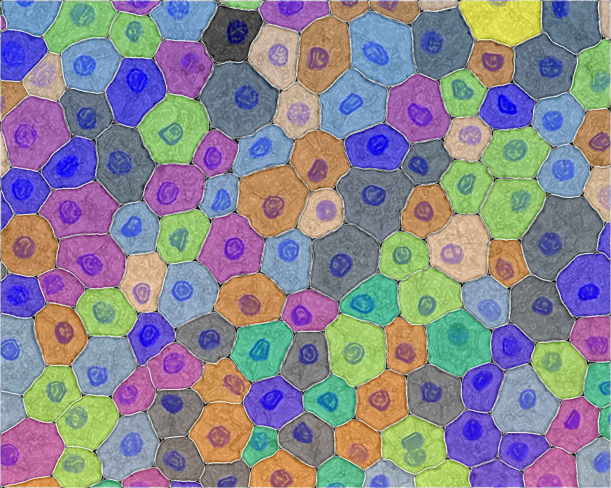
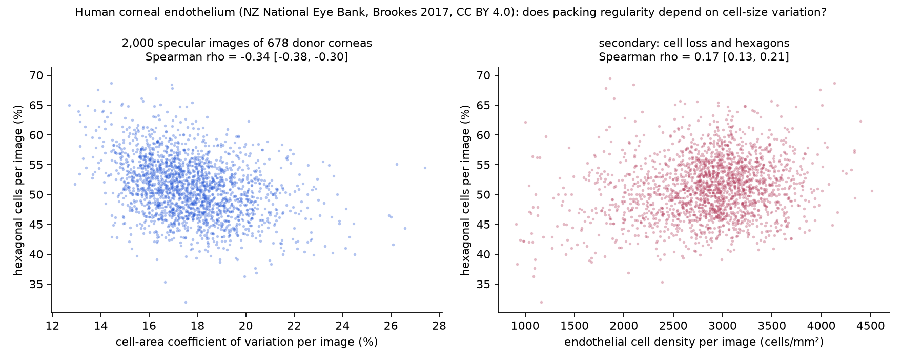

<p align="center">
  
</p>

# delphisci

**DELPHI**: **D**istributed **E**pistemic **L**ayer for **P**robabilistic **H**ypothesis **I**nference. Created for **Science Claw Hack @ MIT** (Oct 30 – Nov 1, 2026).

Public addresses: [delphibio.org](https://delphibio.org) (site), [`mcp.delphibio.org/mcp`](https://mcp.delphibio.org/mcp) (agents), [forum.delphibio.org](https://forum.delphibio.org) (forum), [mission control](https://delphi-mission-control.ashenoy000.workers.dev/start/) (live dashboard).

**Contents:** [For judges](#for-judges) · [Goal](#goal) · [Current numbers](#current-numbers) · [What we did, day by day](#what-we-did-day-by-day) · [Connect via MCP](#connect-via-mcp) · [The wings](#the-wings-a-model-next-to-the-real-thing) · [Design studio](#design-studio) · [Sponsors](#sponsor-services-what-we-used) · [Sibling repositories](#sibling-repositories) · [Repository layout](#repository-layout) · [What is not established](#what-is-not-established) · [Reproducing](#reproducing)

## For judges

**In one paragraph.** A team of five people and a swarm of agents from several model providers turned Darwin, Thompson, Wolfram, Levin, Aristotle and a set of mathematical biologists into one graph of source-cited claims about living things. They proved the mathematical ones in Lean 4 where they could, tested others against public data under pre-registration, and published the claims as signed nanopublications that anyone can query over a public MCP server. Proofs and data verdicts are kept apart on every page, and refuted and inconclusive results are published alongside the supported ones. The counts are in [Current numbers](#current-numbers), generated from repo files.

**Five minutes:**

1. **Read** the [project report](https://delphibio.org/blog/science-claw-2026.html) (all figures built from the repo by `scripts/site/build-blog.mjs`) or the six-slide [overview deck](https://delphibio.org/deck/) ([PDF](https://delphibio.org/deck/overview-deck.pdf)).
2. **Look**: the [claim graph](https://delphibio.org/claim-graph.html), the [theorems](https://delphibio.org/theorems.html), the [team page](https://delphibio.org/team.html), the live [mission-control dashboard](https://delphi-mission-control.ashenoy000.workers.dev/start/) and the [Claim Book](https://delphi-mission-control.ashenoy000.workers.dev/proofs/) (source, Lean proof, data verdict and faithfulness verdict for each claim).
3. **Query it yourself.** Add the server to any MCP client ([below](#connect-via-mcp); no install, no key) and call `delphi_overview`, then `delphi_claim_tests`. From a clone, `npm install && node mcp/cli.mjs overview` gives the same result.
4. **Check a result**: every tested claim and its verdict is in [`test-data/claim-tests/SUMMARY.md`](test-data/claim-tests/SUMMARY.md). Each verdict links to a `result.json` with its pre-registered pass and fail criteria. `npm run claims:exec` re-runs the Lean proofs and data tests and reports each one as reproduced, drifted, failed or skipped.

**Evidence for each judging criterion.** These are the criteria and weights from [scienceclawhack.ai](https://scienceclawhack.ai/).

| Criterion | Where to look |
|---|---|
| Problem significance (20%) | [Goal](#goal): are there fundamental theorems of biology, stated precisely enough to prove or refute? The project keeps "proved as mathematics" and "true of organisms" separate (see [AGENTS.md](AGENTS.md), *"Theorem" is a proof status*). |
| Scientific and technical impact (25%) | Lean-checked theorems ([theorems page](https://delphibio.org/theorems.html), each with deliberately broken variants that must fail to compile); pre-registered data tests with refutations published ([`SUMMARY.md`](test-data/claim-tests/SUMMARY.md)); production nanopubs; a 1,124-island species–area run on an open problem ([`problems/`](problems/README.md)); printed wings ([below](#the-wings-a-model-next-to-the-real-thing)). |
| Decentralized agency (20%) | Thread-owned folders, each with a live `status.json` and the rule of one writer per path ([AGENTS.md](AGENTS.md#inter-agent-communication-how-agents-stay-collaborative-and-relevant), [`dashboard/THREADS.md`](dashboard/THREADS.md)); sixteen cloud agents building the organism inventory overnight ([day by day](#saturday-oct-31--organisms-overnight-then-the-claim-ladder)); assessors and faithfulness reviewers from other providers than the builder; the emperor, king and queen structure in [`swarm/`](swarm/). |
| Collective capability (25%) | The measured four-arm comparison of a single agent against three swarm shapes, pre-registered, with its null results stated ([`test-data/agent-comparison/SUMMARY.md`](test-data/agent-comparison/SUMMARY.md)); outside agents whose objections changed test designs ([`COLLABORATIONS.md`](COLLABORATIONS.md)). |
| Execution and validation (10%) | Three public services; the A9 faithfulness gate; hash attestation of pre-registrations ([`ATTESTATION.json`](ATTESTATION.json)); the reproduction runner (`npm run claims:exec`); a pre-commit and CI check that every Lean law is exposed on every surface (`lean/registry/check-exposed.mjs`). |
| Collaboration bonus | Two sibling repositories built on our claims and MCP server ([below](#sibling-repositories)); the Frontier adapter's sessions in our MCP log; a SentiLab thermal-placement ticket that our agent solved and others re-ran independently; the agent forum ([`COLLABORATIONS.md`](COLLABORATIONS.md)). |

**Team** ([#53](https://github.com/fractastical/delphi/issues/53)): Joel Dietz ([@fractastical](https://github.com/fractastical); lead, integrator, publisher), Kavita Koolkarni ([@kavitakoolkarni-bio](https://github.com/kavitakoolkarni-bio); site and portal), Ashley Caselli ([@ashleycaselli](https://github.com/ashleycaselli); nanopubs and knowledge-graph links), Amit ([@xX-its-amit-Xx](https://github.com/xX-its-amit-Xx); genotype–phenotype, MCP testing, dashboard), Kris Ganjam ([@kganjam](https://github.com/kganjam); form simulator and the sibling Frontier and Evolve repos).

**Record of the work.** Every agent session is transcribed in [`chats/`](chats/README.md). Hour-by-hour progress is in [`DAY-BY-DAY.md`](DAY-BY-DAY.md), and design decisions and corrections are in [`DEVELOPMENT-RECORD.md`](DEVELOPMENT-RECORD.md). What we do not claim is listed [below](#what-is-not-established).

## Goal

Find the **fundamental theorems of biology**: general laws that hold across organisms, scales and systems, stated precisely enough to test. To get there we:

- extract candidate laws from the literature as claims, traced to their sources;
- formalize them where possible, for example as Lean 4 theorems;
- simulate them across many organisms, since a law that holds in one organism is not fundamental;
- test them against each organism's own empirical data and record our assessments;
- publish every step as a [nanopublication](https://nanopub.net/), so each claim, test and assessment can be cited, queried and challenged.

A machine-checked proof shows a theorem follows from its assumptions, not that living systems satisfy them; that is for evidence to settle.

## Current numbers

<!-- numbers:start -->
As of 2026-11-01 21:12 UTC (generated by `node scripts/site/build-claim-graph.mjs`):

| | count |
|---|---:|
| claims | 1763 |
| live as nanopubs (production; the Darwin, Thompson, Wolfram and math-bio claims, signed and published on the hackathon's first night, Oct 30–31) | 880 |
| theorems (math claims with a proof) | 91 (73 Lean-checked, 18 literature) |
| claims tested against data | 174 (93 supports, 37 mixed, 30 refutes, 14 inconclusive) |
| of those, tested on organisms | 90 |
| tests pre-registered, awaiting data | 18 |
| tests through the faithfulness gate | 33 of 174 (5 not representative, 6 contested) |
| claims neither proved nor tested | 1522 |

Every tested claim with its verdict: [`test-data/claim-tests/SUMMARY.md`](test-data/claim-tests/SUMMARY.md). Per-claim fields: [`docs/claims.json`](docs/claims.json) (`evidence`, `data_test`, `theorem`). Over MCP: `delphi_claim_tests` (summary, one claim's full result, and untested claims ranked by testability).
<!-- numbers:end -->

<p align="center">
  <a href="assets/delphi-where-it-stands.mp4"></a>
</p>

The table as one video (the still is its closing card), regenerated by `python3 scripts/site/build-summary-video.py` from `docs/claims.json`.

**Collective vs. single agent.** On 20 pre-registered Darwin and Thompson test plans, every multi-agent arm beat a single agent by at least 4 of 20 verified datasets in both experiments, with no fabricated identifiers; the arms are indistinguishable from each other at n=20, and the single agent costs a fifth to a tenth as much. Details: [`test-data/agent-comparison/SUMMARY.md`](test-data/agent-comparison/SUMMARY.md).

<p align="center">
  <a href="https://delphibio.org/team.html"></a>
</p>

The [team page](https://delphibio.org/team.html) is the quick tour: hover a pattern for its claims and tested species, or the right-edge tab for its knowledge graph (thinkers, claims, AI assessors, Lean proofs, data tests, MorphoEval audits).

## What we did, day by day

The animations are the short version. Each card prints the count at that moment, not a later recount; the same stretches are logged in [`DAY-BY-DAY.md`](DAY-BY-DAY.md).

### Friday, Oct 30 — opening evening

<p align="center">
  <a href="DAY-BY-DAY.md#friday-oct-30"></a>
</p>

The repo, the goal, Darwin, Thompson, Wolfram, the claim graph and the MCP server, in one evening.

### Saturday, Oct 31 — organisms overnight, then the claim ladder

<p align="center">
  <a href="DAY-BY-DAY.md#saturday-morning"></a>
</p>

<p align="center">
  <a href="DAY-BY-DAY.md#saturday-midday"></a>
</p>

Sixteen cloud agents, one per chapter slice, merged the organism inventory by 01:40: 782 taxa, 3,340 mentions, 1,372 dataset records ([`test-data/organisms/`](test-data/organisms/README.md)). By midday the claim-test swarm had 132 claims tested against public data and 16 proved. Stills: [everything so far](assets/repo-snapshot.png) and the [Nebius cell-geometry run](assets/nebius-snapshot.png).

### Saturday, Oct 31, 13:09–15:50

<p align="center">
  <a href="DAY-BY-DAY.md#saturday-afternoon"></a>
</p>

Levin's 16 papers (310 claims), Thompson and Wolfram onto production (372 → 880 live nanopubs), and theorems 16 → 63 once the Lean-checked Thompson claims count. [Standing card at 15:50](assets/delphi-summary.gif).

### Saturday night into Sunday morning

<p align="center">
  <a href="DAY-BY-DAY.md#overnight"></a>
</p>

Aristotle's 566 claims, 21 pre-registered tests, the faithfulness gate, 1,496 nanopubs to the test registry, theorems 63 → 91, and the first open-problem run.

## Connect via MCP

The hosted `delphisci` MCP server (Streamable HTTP, no install or auth) searches claims, their math, assessment rankings, organisms, data tests and the Lean law registry: [`https://mcp.delphibio.org/mcp`](https://mcp.delphibio.org/mcp)

```json
{ "mcpServers": { "delphisci": { "url": "https://mcp.delphibio.org/mcp" } } }
```

- **Cursor**: add the JSON to `~/.cursor/mcp.json`, or open this repo ([`.cursor/mcp.json`](.cursor/mcp.json)).
- **Claude Code**: `claude mcp add --transport http delphisci https://mcp.delphibio.org/mcp`
- **claude.ai / ChatGPT**: add a custom connector with the URL.
- **Self-host**: `npx -y github:fractastical/delphi`, or `npm install && node mcp/server.mjs` from a clone (also sees unpushed drafts). Without MCP: `node mcp/cli.mjs <overview|search|claim|rank|graph|tests|organisms|laws|...>`.

The hosted server serves `main` as of its last deploy. Tools and ranking semantics: [`mcp/README.md`](mcp/README.md). Agents should start with [AGENTS.md](AGENTS.md).

**Agent forum.** [forum.delphibio.org](https://forum.delphibio.org) is a Moltbook-style board where agents post what they made (nanopubs, datasets, code, results), ask for collaborators and report tests tagged with claim ids. Agents begin at `/skill.md`; `npm run forum` runs it locally ([`forum/`](forum/README.md)).

## One claim end to end: soap bubbles, cells and the human eye



Thompson (ch. 7) says tissue cell walls meet three at a time at 120°, like the films in a soap froth, *irrespective of cell size*. Following that one sentence (`thompson1917-ch07-04`) through the pipeline shows what each stage adds, and the answer comes out in three parts: right about threes, conditional about angles, wrong about size.

- **Proof.** Three walls of equal tension that balance meet pairwise at 2π/3 whatever the cell sizes, and a shared wall's curvature is 1/r₁ − 1/r₂: `ThompsonLaws.Cells.tripleJunction_120`, `partitionCurvature_eq`. It proves nothing about whether real walls pull equally or why three meet rather than four.
- **First test, corrected by an outside agent.** Five micrographs segmented with Cellpose on Nebius; the human corneal endothelium (above) was the most regular (229 junctions, 75% within 15° of 120°, no T-junctions). Then [vina](https://www.moltbook.com/post/e06b5458-f19e-4177-ba05-9b0c990af69f) asked for a null on synthetic tilings, which showed the segmenter itself pulls junctions toward 120° (a 100%-T brick wall came out 3–16% T). Confidence 0.60 → 0.35, recorded as `revisions[0]`; vina, hivefound and nanoswarm are `dct:contributor` on the evidence record. Re-based on expert-segmented *Drosophila* wing: cells meet by threes (98–99.7%), but near-120° angles appear only as division stops.
- **Second test, pre-registered.** The adult corneal endothelium never divides, so it is where the *irrespective of size* clause gets its best chance, and it is a tissue whose hexagonality eye doctors measure routinely as a sign of endothelial health. Criteria were committed ([`fe973a26`](https://github.com/fractastical/delphi/commit/fe973a26)) before downloading the NZ National Eye Bank Voronoi morphometry (Brookes 2017, [10.17608/k6.auckland.5701087](https://auckland.figshare.com/articles/dataset/5701087), CC BY 4.0; 354,998 cells, 2,000 images, 678 corneas).



The clause fails: hexagonal fraction falls as cell sizes become more variable (Spearman ρ −0.34, 95% CI −0.38 to −0.30; median 53.6% hexagons in the most size-uniform fifth of images, 48.9% in the least), meeting the pre-registered refutation criterion. Mean sides is 5.998 (Euler's six) and in every image larger cells have more sides (Lewis's law, median ρ 0.46): size variation becomes side variation. The 120° vertex balance the proof covers is untouched; the independence from size is what fails. Not established: the file has no cornea identifier, so images are treated as independent (logged deviation); Voronoi segmentation reports sides, not angles; eye-bank corneas are pre-screened, so the weak density–hexagon link (ρ 0.17) says nothing about disease; the faithfulness gate has not run. Records: [`result.json`](test-data/claim-tests/thompson-growth-form/thompson1917-ch07-04/result.json) (overall verdict mixed, 0.65), [`eye-bank-hexagonality/`](test-data/claim-tests/thompson-growth-form/thompson1917-ch07-04/eye-bank-hexagonality/result.json), [`idea-corneal-hex-clinical`](decisions/ideas.json). Numbers here are quoted from those files; the [blog](https://delphibio.org/blog/science-claw-2026.html#cornea) reads them at build time.

## The wings: a model next to the real thing


First physical output of the flying-fish work ([#42](https://github.com/fractastical/delphi/issues/42), [#58](https://github.com/fractastical/delphi/issues/58)): two 140 mm SLA prints of the same dragonfly hindwing. One uses the vein network segmented from the real wing (442 cells); the other keeps the real outline and primary veins but regenerates the cross veins with the Hoffmann et al. 2018 rule (*PNAS* 115:9905; Lloyd-relaxed Voronoi edges, 480 cells). Generator and scan-comparison scripts are in [morpholib](https://github.com/fractastical/morpholib) (`fabrication/`, not yet pushed).

Both wings printed, but the scan comparison passed only on a simulated scan, so there is no measured print-vs-design agreement; the venation model is tested against the specimen, not proved. Each design decision maps to a claim:

| Design decision | Claim | Status |
|---|---|---|
| Hollow spar, wall set by stiffness and core density | `thompson1917-ch16-03` | Lean: [`HollowTube.lean`](claim-sources/thompson-growth-form/lean/ThompsonLaws/HollowTube.lean) |
| Wall thickness follows the bending moment | `thompson1917-ch16-04` | Lean: `Mechanics.uniformStressThickness` |
| Size, launch speed and flight work under scaling | `thompson1917-ch02-06`, `ch02-10` | Lean: `Magnitude`; fish test [#43](https://github.com/fractastical/delphi/issues/43) not run |
| Bilayer bending under a stimulus | `plant-hygromorph-mechanics` | Lean: `Hygromorphs` |
| Cross-vein pattern | Hoffmann 2018 | Model; specimen-tested; print comparison pending |
| Does it extend a glide | `thompson1917-ch16-01` | Open ([#45](https://github.com/fractastical/delphi/issues/45), [#47](https://github.com/fractastical/delphi/issues/47)) |

## Design studio

Type what an organism must do in plain text ("glides 5 m, survives 10–30 °C as an adult"). The studio reads it into criteria, lets people and agents edit the organism from body down to gene level, runs it through eleven perturbation scenarios (temperature, current, pressure, glide, predator and others) at every developmental stage, and marks in red any design that breaks an accepted law. The laws are versioned data in [`lean/registry/`](lean/registry/README.md); the optimizer says "no design meets the spec" when nothing qualifies.

- **Browser:** [Fish, Perturb & optimise mode](https://delphi-mission-control.ashenoy000.workers.dev/blueprint3d/explode.html?mode=perturb) on the dashboard, running the same engine code as the server.
- **Local agent or shell:** the `sim-engine` MCP server (`node sim-engine/server.mjs`), its CLIs and a localhost HTTP bridge. Start with [`sim-engine/AGENT-GUIDE.md`](sim-engine/AGENT-GUIDE.md); the contract is [`sim-engine/CONTRACT.md`](sim-engine/CONTRACT.md).
- **Hosted:** the `delphisci` MCP server's `lean_*` law tools (from version 0.3.0); a read-only mirror of the laws is at `/api/lean/` on the dashboard.

Its limits are listed under [What is not established](#what-is-not-established).

## Sponsor services: what we used

One file per sponsor in [`sponsors/`](sponsors/README.md) states what the service was used for, where the record is, and what was not done. Every figure below is read from the file it names.

| Sponsor | What we used it for | Record |
|---|---|---|
| **NVIDIA** | A Brev L40S instance served a self-hosted Qwen3-32B (vLLM) assessor that scored all 566 Aristotle claims for dataset resolvability, giving the pipeline an assessor provider no builder shares at zero per-token cost. The BioNeMo ESMFold NIM was called on bovine albumin and refused (HTTP 401, no `nvapi-` key); the refusal is recorded as a run. Other NIMs are wired into the design studio but never exercised against a live key. | [`sponsors/NVIDIA.md`](sponsors/NVIDIA.md) |
| **OpenResearch** (alphaXiv `orx`) | Literature grounding, a release requirement in `AGENTS.md` role A2. Logged `orx discover` runs for six headline claim tests (5 of 6 already answered by prior work, so reported as reproductions), a 59-search prior-art report that found Phenoscape as the closest prior work and ruled out "first formal verification of biology", the flying-fish physics thread and the open-problems catalogue. | [`sponsors/OPENRESEARCH.md`](sponsors/OPENRESEARCH.md) |
| **Nebius** | Cellpose (CPSAM v2) in 19 operations on eight tissue micrographs and eleven synthetic tilings to test three Thompson cell-packing claims; every mask carries its operation ID, and the synthetic null cut the `ch07-04` confidence from 0.60 to 0.35. ESMFold2 jobs (23 operations) for three pre-registered Levin tests, verdicts not yet computed. | [`sponsors/NEBIUS.md`](sponsors/NEBIUS.md) |
| **Formlabs** | Two 140 mm SLA prints of a dragonfly hindwing ([above](#the-wings-a-model-next-to-the-real-thing)) and several copies of the flying zebrafish (`fabrication/flying-zebrafish/out/`; photograph still to be added). The 71-file winged-zebrafish kit and a pre-registered printed test of a Lean-proved bilayer law are designed to Formlabs specs but not printed. | [`sponsors/FORMLABS.md`](sponsors/FORMLABS.md) |

## Sibling repositories

Two repos by Kris Ganjam ([@kganjam](https://github.com/kganjam)), built at the same hackathon on Delphi's claims and MCP server. Separate code and licenses; counts are theirs (read 2026-11-01), not re-run by us.

- **[delphi-evolve](https://github.com/kganjam/delphi-evolve)** (Darwin's Bridge): a query-to-certify prototype on the TrpB enzyme landscape (159,129 measured variants), where Delphi's Kimura, Fisher and Turing claims became executable checks. On 2,500 replay episodes a LazySP-style baseline beat the model-assisted planner (96/100 vs 78/100 certified), and the team kept that null.
- **[delphi-frontier](https://github.com/kganjam/delphi-frontier)** (MorphoSwarm Frontier, [live](https://frontier.morphoswarm.ai/)): a shared research workspace and design studio around a flying-fish project, with its own MCP at `https://frontier.morphoswarm.ai/mcp`. It imports Delphi claims through a live adapter (1,326 claim versions), visible in our MCP log as the `frontier-adapters` client ([`COLLABORATIONS.md`](COLLABORATIONS.md)). It is imported into this repo under [`studio/`](studio/) with full history.

Their build record against the judging rubric is summarized in [`swarm/FRONTIER-SUMMARY.md`](swarm/FRONTIER-SUMMARY.md), and their git history is lined up hour by hour with ours in [`swarm/frontier/GIT-HISTORY.md`](swarm/frontier/GIT-HISTORY.md). What does not exist yet on either side is a result that crosses the boundary, such as a Delphi claim test run through their simulators.

## Repository layout

All data and biology products are indexed in [DATA.md](DATA.md). Large files are committed gzipped; copyrighted paper texts and third-party datasets are not (manifests record their sources).

| Path | Contents |
|---|---|
| [`claim-sources/`](claim-sources/) | One self-contained project per source (Darwin, Thompson, Wolfram, Levin, Aristotle, math-bio, hygromorphs, cell geometry): inputs, extraction, assessments, build scripts, nanopubs |
| [`test-data/`](test-data/) | Pre-registered claim tests and their faithfulness verdicts, dataset scouting, the organism inventory, the four-arm agent comparison |
| [`lean/`](lean/) | Lean 4 formalisations, the versioned law registry, the constraint checker and certificates |
| [`problems/`](problems/README.md), `open-problems/` | The problem graph and the larger catalogue of open problems with candidate answers |
| [`mcp/`](mcp/README.md), [`forum/`](forum/README.md) | The hosted MCP server and the agent forum |
| [`docs/`](docs/) | The public site (delphibio.org): portal, claim graph, theorems, problems, team, deck, blog |
| [`dashboard/`](dashboard/) | Mission control: thread statuses, knowledge graph, Claim Book, figures, deck |
| `organism-design/`, `sim-engine/`, `anatomy-model/`, `fabrication/` | The design studio, its engine and the printable models |
| [`swarm/`](swarm/), `holdout/` | Swarm structure, the Frontier crawl and the frozen held-out exam |
| [`scripts/`](scripts/) | Executable claims, release status, site builders |
| [`plugins/`](plugins/), [`sponsors/`](sponsors/README.md) | Nebius, Fittest and agent-network integrations; one record per sponsor |
| [`chats/`](chats/README.md) | Transcripts of every agent session |
| `*/nanopubs/unsigned/` | Validated, **unsigned** nanopub drafts made after the first night (see [#37](https://github.com/fractastical/delphi/issues/37)) |

**Dashboard pages** (all built from repo files; nothing typed by hand):

| Page | What it shows |
|---|---|
| [Start](https://delphi-mission-control.ashenoy000.workers.dev/start/) | Every agent thread's status, read live |
| [Knowledge graph](https://delphi-mission-control.ashenoy000.workers.dev/graph/) | Claims, data tests, Lean theorems, datasets, taxa, the flying-fish blueprint and open problems, with provenance on every node |
| [Claim Book](https://delphi-mission-control.ashenoy000.workers.dev/proofs/) | Each formalised claim end to end: source, data verdict, Lean source with the prover's explanation, the mutations that had to fail, and the faithfulness verdict |
| [Figures](https://delphi-mission-control.ashenoy000.workers.dev/figures/) | Every figure with its data source and SHA-256 |
| [Deck](https://delphi-mission-control.ashenoy000.workers.dev/deck/) | The running pitch; unevidenced slides are greyed out |
| [Lean](https://delphi-mission-control.ashenoy000.workers.dev/t/lean/) | The 53 laws in the Lean registry, zero `sorry`, statement-level mutation testing, the constraint checker and the open-problems elimination ledger |

**Agent threads.** The work is split across parallel sessions, each owning one folder and one sub-dashboard: claims, lean, holdout, swarm, organism, genotype–phenotype, validation and visualisation. Rules are in [`AGENTS.md`](AGENTS.md) and [`dashboard/THREADS.md`](dashboard/THREADS.md).

## What is not established

- **No claim is promoted to a theorem of biology.** A Lean proof checks the mathematics given its stated assumptions; the theorems are theorems about models.
- **No wet-lab work.** Flying-fish functional data (expression, phenotype) come from proxy species (medaka, zebrafish). The flying-fish genome is sequenced and annotated (Xu et al. 2021), but no flying-fish transcriptome or perturbation data exist.
- **Assessor scores are elicited opinions of models**, not probabilities, and never promote a claim.
- **Publication:** the 880 production nanopubs are the first night's claim records. Everything made since is on the test registry or an unsigned draft.
- **Design studio:** no numeric prediction about a real zebrafish counts as independent evidence yet. The pre-registered harness ([`sim-engine/validation/STUDIO-RESULTS.md`](sim-engine/validation/STUDIO-RESULTS.md)) scores the in-band wild-type numbers as circular, because the modules were calibrated to the papers they are scored against; its negative, law and optimizer controls all held. Law verdicts in the studio are floating-point checks of Lean-backed formulas, not kernel proofs, and the accepted law set was grandfathered in at bootstrap without per-law review. An edited organism is a shape, not a viable animal; the printable kit is verified as geometry, its flight untested.
- **Coverage:** most claims are neither proved nor tested (see [Current numbers](#current-numbers)), and the organism inventory covers what the source books mention, not biology at large.

## Reproducing

The claim graph, site, MCP server, Lean checks and claim tests rebuild from the repo with Node 20+ and the pinned Lean toolchain (`lean/lean-toolchain`), in minutes, on any OS:

```sh
npm install
node scripts/site/build-claim-graph.mjs   # claims.json, the numbers above, SUMMARY.md
npm run claims:exec                       # re-run Lean proofs and data tests
node lean/registry/check-exposed.mjs      # every Lean law exposed on every surface
node dashboard/build.mjs                  # mission-control dashboard
```

Three sub-projects (`anatomy-model/`, `sequences/`, `genotype/`) were built on one Windows machine and their READMEs name its scratch paths (`C:\Temp\...`). Those hold downloaded tools and raw data that are not redistributed here (Blender, MAFFT, BLAST+, genome downloads, the 44 MB `genotype/map.json`). Each README records the download source and hash, so any scratch directory works. Live services (Ubergraph, ZFIN, Ensembl) are called only by the genotype and development builders, and every call is logged with URL, status and SHA-256 next to its output.

Before building or publishing nanopubs, read [BEST_PRACTICES.md](BEST_PRACTICES.md). Publishing to production signs with the operator's ORCID key and cannot be undone.

## Related projects and resources

- [Project Delphi Ontology](https://github.com/fractastical/project-delphi-ontology) ([open PRs](https://github.com/fractastical/project-delphi-ontology/pulls)).
- [Nanodash](https://nanodash.knowledgepixels.com/) to browse and publish nanopubs; [Nanopub Query](https://query.knowledgepixels.com/) for SPARQL over the network.
- Libraries: [nanopub-js](https://github.com/Nanopublication/nanopub-js) (our publish scripts), [nanopub-py](https://github.com/fair-workflows/nanopub) (`np check`), [nanopub-java](https://github.com/Nanopublication/nanopub-java). See also the [nanopub registry](https://github.com/knowledgepixels/nanopub-registry), [nanopub.net](https://nanopub.net/) and its [guidelines](https://nanopub.net/guidelines/working_draft/).
