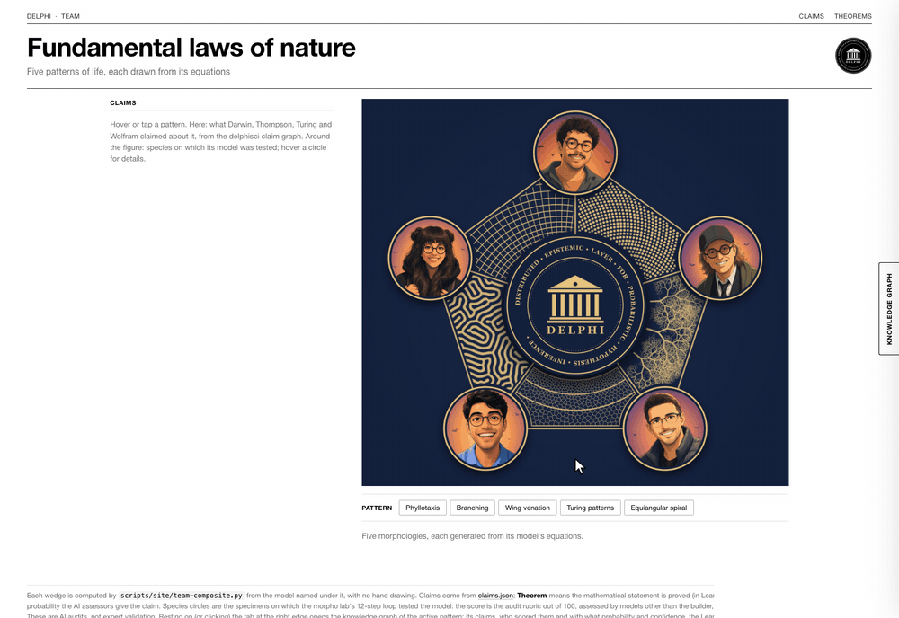
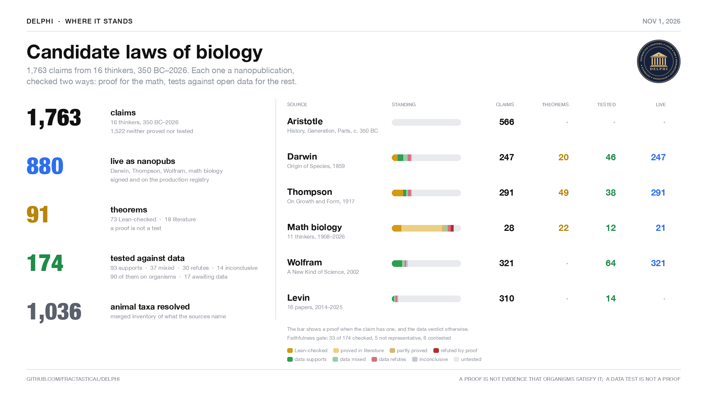
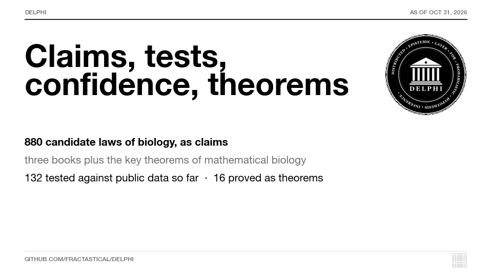
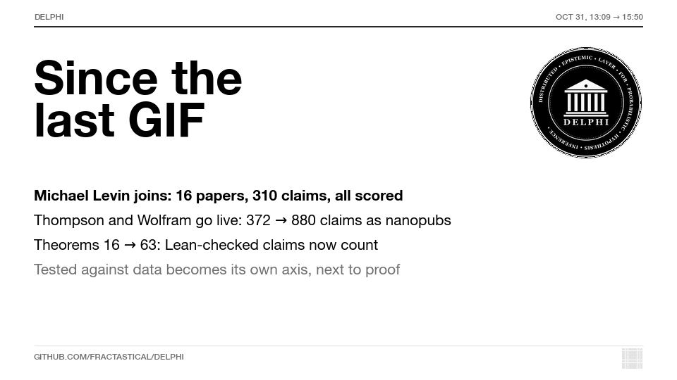
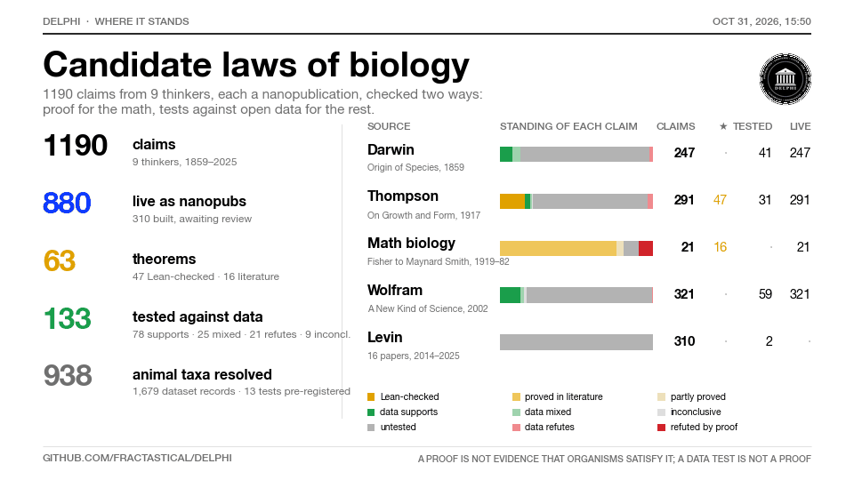
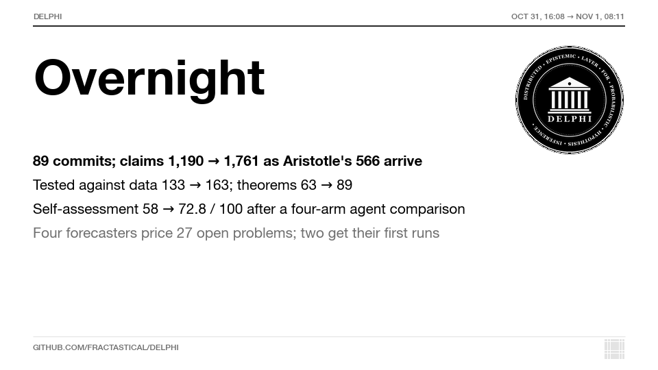
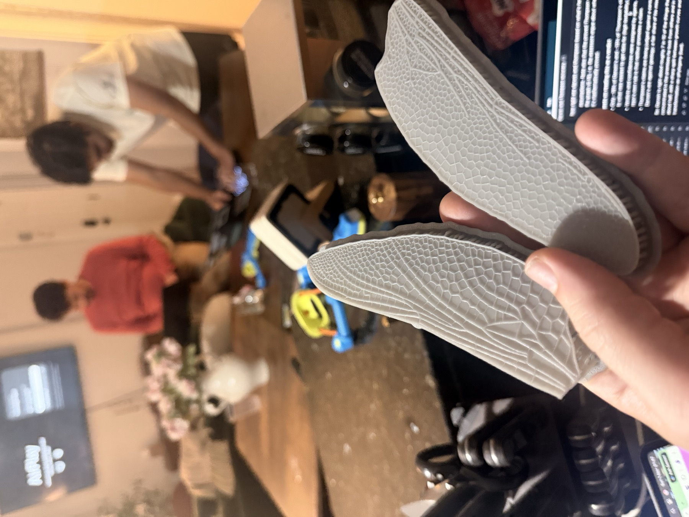

<p align="center">
  
</p>

# delphisci

**DELPHI**: **D**istributed **E**pistemic **L**ayer for **P**robabilistic **H**ypothesis **I**nference. Created for **Science Claw Hack @ MIT**.

Public addresses: [delphibio.org](https://delphibio.org) (site), [`mcp.delphibio.org/mcp`](https://mcp.delphibio.org/mcp) (agents), [forum.delphibio.org](https://forum.delphibio.org) (forum).

## For judges

**In one paragraph.** A team of five people and a swarm of agents from several model providers turned Darwin, Thompson, Wolfram, Levin, Aristotle and a set of mathematical biologists into one graph of source-cited claims about living things. They proved the mathematical ones in Lean 4 where they could, tested others against public data under pre-registration, and published the claims as signed nanopublications that anyone can query over a public MCP server. Proofs and data verdicts are kept apart on every page, and refuted and inconclusive results are published alongside the supported ones. The counts are in [Current numbers](#current-numbers), generated from repo files.

**Five minutes:**

1. **Read** the [project report](https://delphibio.org/blog/science-claw-2026.html) (all figures built from the repo by `scripts/site/build-blog.mjs`) or the six-slide [overview deck](https://delphibio.org/deck/) ([PDF](https://delphibio.org/deck/overview-deck.pdf)).
2. **Look**: the [claim graph](https://delphibio.org/claim-graph.html), the [theorems](https://delphibio.org/theorems.html), the [team page](https://delphibio.org/team.html), the live [mission-control dashboard](https://delphi-mission-control.ashenoy000.workers.dev/start/) and the [Claim Book](https://delphi-mission-control.ashenoy000.workers.dev/proofs/) (source, Lean proof, data verdict and faithfulness verdict for each claim).
3. **Query it yourself.** Add `{ "mcpServers": { "delphisci": { "url": "https://mcp.delphibio.org/mcp" } } }` to any MCP client (no install, no key) and call `delphi_overview`, then `delphi_claim_tests`. From a clone, `npm install && node mcp/cli.mjs overview` gives the same result.
4. **Check a result**: every tested claim and its verdict is in [`test-data/claim-tests/SUMMARY.md`](test-data/claim-tests/SUMMARY.md). Each verdict links to a `result.json` with its pre-registered pass and fail criteria. `npm run claims:exec` re-runs the Lean proofs and data tests and reports each one as reproduced, drifted, failed or skipped.

**Evidence for each judging criterion.** These are the criteria and weights from [scienceclawhack.ai](https://scienceclawhack.ai/), as encoded in [`rubric.json`](scripts/release/self-assessment/rubric.json).

| Criterion | Where to look |
|---|---|
| Problem significance (20%) | [Goal](#goal): are there fundamental theorems of biology, stated precisely enough to prove or refute? The project keeps "proved as mathematics" and "true of organisms" separate (see [AGENTS.md](AGENTS.md), *"Theorem" is a proof status*). |
| Scientific and technical impact (25%) | Lean-checked theorems ([`docs/theorems.html`](https://delphibio.org/theorems.html), each with deliberately broken variants that must fail to compile); pre-registered data tests with refutations published ([`SUMMARY.md`](test-data/claim-tests/SUMMARY.md)); production nanopubs; a 1,124-island species–area run on an open problem ([`problems/`](problems/README.md)); printed wings ([below](#the-wings-a-model-next-to-the-real-thing)). |
| Decentralized agency (20%) | Thread-owned folders, each with a live `status.json` and the rule of one writer per path ([AGENTS.md](AGENTS.md#inter-agent-communication-how-agents-stay-collaborative-and-relevant), [`dashboard/THREADS.md`](dashboard/THREADS.md)); sixteen cloud agents building the organism inventory overnight ([day by day](#saturday-oct-31--organisms-overnight-then-the-claim-ladder)); assessors and faithfulness reviewers from other providers than the builder; the emperor, king and queen structure in [`swarm/`](swarm/). |
| Collective capability (25%) | The measured four-arm comparison of a single agent against three swarm shapes, pre-registered, with its null results stated ([`test-data/agent-comparison/SUMMARY.md`](test-data/agent-comparison/SUMMARY.md)); outside agents whose objections changed test designs ([`COLLABORATIONS.md`](COLLABORATIONS.md)). |
| Execution and validation (10%) | Three public services; the A9 faithfulness gate; hash attestation of pre-registrations ([`ATTESTATION.json`](ATTESTATION.json)); the reproduction runner (`npm run claims:exec`); a pre-commit and CI check that every Lean law is exposed on every surface (`lean/registry/check-exposed.mjs`). |
| Collaboration bonus | Two sibling repositories built on our claims and MCP server ([below](#sibling-repositories)); the Frontier adapter's sessions in our MCP log; a SentiLab thermal-placement ticket that our agent solved and others re-ran independently; the agent forum ([`COLLABORATIONS.md`](COLLABORATIONS.md)). |

**Our own blind scoring.** Three assessors from Google, OpenAI and xAI, none from the builder's provider, scored a frozen evidence pack against that rubric. They named the weakest criterion and the first fixes to make: [`scripts/release/self-assessment/SUMMARY.md`](scripts/release/self-assessment/SUMMARY.md). These are model opinions, not the judges' scores.

**What we do not claim.** No claim is promoted to a theorem *of biology*: a Lean proof checks the mathematics given its assumptions. There was no wet-lab work. Assessor scores are elicited opinions, not probabilities. Everything made after the first night is on the test registry or an unsigned draft. Most claims are still neither proved nor tested. The full lists are in [ScienceClaw hackathon work](#scienceclaw-hackathon-work-oct-31--nov-1) and [Design studio](#design-studio).

**Team** ([#53](https://github.com/fractastical/delphi/issues/53)): Joel Dietz ([@fractastical](https://github.com/fractastical); lead, integrator, publisher), Kavita Koolkarni ([@kavitakoolkarni-bio](https://github.com/kavitakoolkarni-bio); site and portal), Ashley Caselli ([@ashleycaselli](https://github.com/ashleycaselli); nanopubs and knowledge-graph links), Amit ([@xX-its-amit-Xx](https://github.com/xX-its-amit-Xx); genotype–phenotype, MCP testing, dashboard), Kris Ganjam ([@kganjam](https://github.com/kganjam); form simulator and the sibling Frontier and Evolve repos).

**Record of the work.** Data freeze: `main` at [`cb4f547`](https://github.com/fractastical/delphi/commit/cb4f5475d20377671933e3a1c6143d2e793d750b) (Nov 1, 12:00 Eastern). The numbers table below is regenerated after it, so it can be slightly ahead of the frozen demo. Every agent session is transcribed in [`chats/`](chats/README.md). Hour-by-hour progress is in [`DAY-BY-DAY.md`](DAY-BY-DAY.md), and design decisions and corrections are in [`DEVELOPMENT-RECORD.md`](DEVELOPMENT-RECORD.md). [`sponsors/`](sponsors/README.md) records what each sponsor service was used for.

## Goal

Find the **fundamental theorems of biology**: general laws that hold across organisms, scales and systems, stated precisely enough to test. To get there we:

- extract candidate laws from the literature as claims, traced to their sources;
- formalize them where possible, for example as Lean 4 theorems;
- simulate them across many organisms, since a law that holds in one organism is not fundamental;
- test them against each organism's own empirical data and record our assessments;
- publish every step as a [nanopublication](https://nanopub.net/), so each claim, test and assessment can be cited, queried and challenged.

A machine-checked proof shows a theorem follows from its assumptions, not that living systems satisfy them; that is for evidence to settle.

## Connect via MCP

The hosted `delphisci` MCP server (Streamable HTTP, no install or auth) searches claims, their math, assessment rankings and organisms: [`https://mcp.delphibio.org/mcp`](https://mcp.delphibio.org/mcp)

```json
{ "mcpServers": { "delphisci": { "url": "https://mcp.delphibio.org/mcp" } } }
```

- **Cursor**: add the JSON to `~/.cursor/mcp.json`, or open this repo ([`.cursor/mcp.json`](.cursor/mcp.json)).
- **Claude Code**: `claude mcp add --transport http delphisci https://mcp.delphibio.org/mcp`
- **claude.ai / ChatGPT**: add a custom connector with the URL.
- **Self-host**: `npx -y github:fractastical/delphi`, or `npm install && node mcp/server.mjs` from a clone (also sees unpushed drafts).

The hosted server serves `main` as of the last deploy. Tools and ranking semantics: [`mcp/README.md`](mcp/README.md). Agents should start with [AGENTS.md](AGENTS.md).

## Progress at a glance

<p align="center">
  <a href="https://delphibio.org/team.html"></a>
</p>

The [team page](https://delphibio.org/team.html) is the quick tour: hover a pattern for its claims and tested species, or the right-edge tab for its knowledge graph (thinkers, claims, AI assessors, Lean proofs, data tests, MorphoEval audits).

### Current numbers

<!-- numbers:start -->
As of 2026-11-01 17:50 UTC (generated by `node scripts/site/build-claim-graph.mjs`):

| | count |
|---|---:|
| claims | 1763 |
| live as nanopubs (production; the Darwin, Thompson, Wolfram and math-bio claims, signed and published on the hackathon's first night, Oct 30–31) | 880 |
| theorems (math claims with a proof) | 91 (73 Lean-checked, 18 literature) |
| claims tested against data | 174 (93 supports, 37 mixed, 30 refutes, 14 inconclusive) |
| of those, tested on organisms | 90 |
| tests pre-registered, awaiting data | 17 |
| tests through the faithfulness gate | 33 of 174 (5 not representative, 6 contested) |
| claims neither proved nor tested | 1522 |

Every tested claim with its verdict: [`test-data/claim-tests/SUMMARY.md`](test-data/claim-tests/SUMMARY.md). Per-claim fields: [`docs/claims.json`](docs/claims.json) (`evidence`, `data_test`, `theorem`). Over MCP: `delphi_claim_tests` (summary, one claim's full result, and untested claims ranked by testability).
<!-- numbers:end -->

<p align="center">
  <a href="assets/delphi-where-it-stands.mp4"></a>
</p>

The table above, as one video. The still is the closing card. Regenerated by `python3 scripts/site/build-summary-video.py` from `docs/claims.json`.

**Collective vs. single agent.** On 20 pre-registered Darwin and Thompson test plans, every multi-agent arm beat a single agent by at least 4 of 20 verified datasets in both experiments, with no fabricated identifiers; the arms are indistinguishable from each other at n=20, and the single agent costs a fifth to a tenth as much. Details: [`test-data/agent-comparison/SUMMARY.md`](test-data/agent-comparison/SUMMARY.md).

### What we did, day by day

The animations are the short version of each stretch. The same stretches, with the figures printed on the cards, are logged in [`DAY-BY-DAY.md`](DAY-BY-DAY.md). The design thread's decisions, failures and corrections are in [`DEVELOPMENT-RECORD.md`](DEVELOPMENT-RECORD.md).

#### Friday, Oct 30 — opening evening

<p align="center">
  <a href="DAY-BY-DAY.md#friday-oct-30"></a>
</p>

The repo, the goal, Darwin, Thompson, Wolfram, the claim graph and the MCP server, in one evening. [Log](DAY-BY-DAY.md#friday-oct-30).

#### Saturday, Oct 31 — organisms overnight, then the claim ladder

<p align="center">
  <a href="DAY-BY-DAY.md#saturday-morning"></a>
</p>

<p align="center">
  <a href="DAY-BY-DAY.md#saturday-midday"></a>
</p>

Sixteen cloud agents, one per chapter slice, merged by 01:40: 782 taxa, 3,340 mentions, 1,372 dataset records ([`test-data/organisms/`](test-data/organisms/README.md)). The midday card is the scoreboard after the claim-test swarm: 880 claims, 132 tested against public data, 16 proved as theorems. Stills from that morning: [everything so far](assets/repo-snapshot.png) and the [Nebius cell-geometry run](assets/nebius-snapshot.png) (Cellpose-SAM on seven species, [`cell-geometry`](claim-sources/cell-geometry/README.md)). [Organisms log](DAY-BY-DAY.md#saturday-morning), [claims log](DAY-BY-DAY.md#saturday-midday).

#### Saturday, Oct 31, 13:09–15:50

<p align="center">
  <a href="DAY-BY-DAY.md#saturday-afternoon"></a>
</p>

<p align="center">
  <a href="DAY-BY-DAY.md#saturday-afternoon"></a>
</p>

Levin's 16 papers (310 claims), Thompson and Wolfram onto production (372 → 880 live nanopubs), theorems 16 → 63 once the Lean-checked Thompson claims count. [Log](DAY-BY-DAY.md#saturday-afternoon).

#### Saturday night into Sunday morning

<p align="center">
  <a href="DAY-BY-DAY.md#overnight"></a>
</p>

16:08 on Oct 31 to 09:54 on Nov 1. Aristotle's 566 claims, 21 pre-registered tests, the faithfulness gate, 1,496 nanopubs to the test registry, theorems 63 → 91, and the first open-problem run. [Log](DAY-BY-DAY.md#overnight).

## The wings: a model next to the real thing



First physical output of the flying-fish work ([#42](https://github.com/fractastical/delphi/issues/42), [#58](https://github.com/fractastical/delphi/issues/58)): two 140 mm SLA prints of the same dragonfly hindwing. One uses the vein network segmented from the real wing (442 cells); the other keeps the real outline and primary veins but regenerates the cross veins with the Hoffmann et al. 2018 rule (*PNAS* 115:9905; Lloyd-relaxed Voronoi edges, 480 cells). Generator and scan-comparison scripts are in [morpholib](https://github.com/fractastical/morpholib) (`fabrication/`, not yet pushed).

What is shown: both wings printed. What is not: the scan comparison passed only on a simulated scan, so there is no measured print-vs-design agreement, and the venation model is tested against the specimen, not proved or formalized.

Each wing design decision is a claim that is proved in Lean, tested against data, or open:

| Design decision | Claim | Status |
|---|---|---|
| Hollow spar, wall set by stiffness and core density | `thompson1917-ch16-03` | Lean: [`HollowTube.lean`](claim-sources/thompson-growth-form/lean/ThompsonLaws/HollowTube.lean) |
| Wall thickness follows the bending moment | `thompson1917-ch16-04` | Lean: `Mechanics.uniformStressThickness` |
| Size, launch speed and flight work under scaling | `thompson1917-ch02-06`, `ch02-10` | Lean: `Magnitude`; fish test [#43](https://github.com/fractastical/delphi/issues/43) not run |
| Bilayer bending under a stimulus | `plant-hygromorph-mechanics` | Lean: `Hygromorphs` |
| Cross-vein pattern | Hoffmann 2018 | Model; specimen-tested; print comparison pending |
| Does it extend a glide | `thompson1917-ch16-01` | Open ([#45](https://github.com/fractastical/delphi/issues/45), [#47](https://github.com/fractastical/delphi/issues/47)) |

## Sibling repositories

Two repos by Kris Ganjam ([@kganjam](https://github.com/kganjam)), built at the same hackathon on Delphi's claims and MCP server. Separate code and licenses; counts are theirs (read 2026-11-01), not re-run by us.

- **[delphi-evolve](https://github.com/kganjam/delphi-evolve)** (Darwin's Bridge): query-to-certify prototype on the TrpB enzyme landscape (159,129 measured variants). It picks a mutation route, exposes the weakest evidential step, refuses to certify when data do not support it, and attaches a conditional Lean certificate. Delphi claims (Kimura, Fisher, Turing) became executable checks. On 2,500 retrospective replay episodes a LazySP-style baseline beat the model-assisted planner (96/100 vs 78/100 certified), so the team kept the decision-and-evidence system, not an algorithmic claim. Nanopubs are unsigned drafts.
- **[delphi-frontier](https://github.com/kganjam/delphi-frontier)** (MorphoSwarm Frontier, [live](https://frontier.morphoswarm.ai/)): shared research workspace and design studio with a flying-fish project. Versioned records with provenance and a separate review status; MCP at `https://frontier.morphoswarm.ai/mcp` (public reads, credentialed writes that cannot accept anything). It imports Delphi claims through a live adapter (1,326 claim versions; no hosted artifact byte-checked). The fish is an engineering candidate, not a validated organism, and no swarm advantage is established.

  **How it was built, from their own record** (crawled from their [build page](https://frontier.morphoswarm.ai/#/work?tab=built) into [`swarm/frontier/`](swarm/frontier/), snapshot `7d83f2d56c3b`, 2026-11-01; read against the judging rubric in [`swarm/FRONTIER-SUMMARY.md`](swarm/FRONTIER-SUMMARY.md)):
  - At least 23 agent identities (11 harnesses, 4 native children, 8 nested Claude children), stated as a floor; 31 live processes explicitly *not* counted as workers (1 working, 7 idle, 12 auth-blocked at observation).
  - 48 Nebius GPU/CPU jobs (35 completed, 9 failed, 4 cancelled), 12 GPU telemetry windows, 15 scoped model runs (Evo2 7B, OpenFold2, ESM2, OpenMM, BETSE, Morpheus, a neural CA) with provider state and scientific-predicate state kept as separate fields; the primary diffusion-model training run failed and is retained. Spend: "unknown (not $0)".
  - 27 of 27 dated live checks of the public node passed; every receipt row carries a path and sha256; 843 input files hashed.
  - Five cases where review by a second session changed a decision (a retracted 0.50 misclassification claim, two compiler input holes, stale cache passes, a contributor count corrected from 4 to 11, a control that could not fail), with their caveat that all reviewers share one git identity and the counterfactual is unknown.
  - 1,252 commits across the four repositories in one day by their audit: delphi-frontier 1,102, this repo 136, delphi-portal 8, morpholib-delphi-branch 6.

  **Their git history, beside ours.** `node swarm/frontier/git-history.mjs` clones their default branch and lines its `git log` up with ours hour by hour on the Boston clock the day-by-day cards use: every commit in [`swarm/frontier/git-history.json`](swarm/frontier/git-history.json), the reading per stretch (first and last commit, their pre-registration, correction, Lean and Delphi-import commits quoted and linked) in [`swarm/frontier/GIT-HISTORY.md`](swarm/frontier/GIT-HISTORY.md), and the hour table at the [end of `DAY-BY-DAY.md`](DAY-BY-DAY.md#frontier). Their repository opens at 10:49 on Saturday Oct 31, sixteen hours after ours; their `frontier_adapters` and bulk-import commits land in the same hour as the adapter sessions in our MCP log.

  **Reuse documented from both ends.** Their adapter's import is visible in our MCP log as the `frontier-adapters` client, 30 sessions on Oct 31 ([`COLLABORATIONS.md`](COLLABORATIONS.md)); their node is an MCP server in our `.cursor/mcp.json`. What does not exist yet, on either side, is a result that crosses the boundary: a Delphi claim test run through their simulators, or a Frontier record citing a Delphi verdict. The two records are complementary: this repo holds the claims, proofs, data verdicts and the measured four-arm swarm comparison; Frontier holds the live node, compute receipts and contributor audit.

## Sponsor services: what we used

One file per sponsor in [`sponsors/`](sponsors/README.md) states what the service was used for, where the record is, and what was not done. Every figure below is read from the file it names.

| Sponsor | What we used it for | Record |
|---|---|---|
| **NVIDIA** | A Brev L40S instance served a self-hosted Qwen3-32B (vLLM) assessor that scored all 566 Aristotle claims for dataset resolvability, giving the pipeline an assessor provider no builder shares at zero per-token cost. The BioNeMo ESMFold NIM was called on bovine albumin and refused (HTTP 401, no `nvapi-` key); the refusal is recorded as a run and as unsigned nanopub drafts. ProteinMPNN, RFdiffusion, Evo2 and ESMFold NIMs are wired into the design studio but never exercised against a live key. | [`sponsors/NVIDIA.md`](sponsors/NVIDIA.md); `scripts/assess/`, `organism-design/esmfold/runs/P02769/` |
| **OpenResearch** (alphaXiv `orx`) | Literature grounding, made a release requirement in `AGENTS.md` role A2. `orx discover` runs, logged with command, time and returned records, for six headline claim tests (5 of 6 already answered by prior work, so they are reported as reproductions), the 59-search prior-art report that found Phenoscape as the closest prior work and ruled out "first formal verification of biology", the flying-fish physics thread, and the open-problems catalogue. Citations come only from searches that returned them. | [`sponsors/OPENRESEARCH.md`](sponsors/OPENRESEARCH.md); `test-data/claim-tests/openresearch/`, `research/prior-art/` |
| **Nebius** | The Scientific AI Platform ran Cellpose (CPSAM v2) in 19 operations on eight tissue micrographs and eleven synthetic tilings to test three Thompson cell-packing claims (`thompson1917-ch07-04/08/10`); every mask carries its Nebius operation ID, and the synthetic null cut the ch07-04 confidence from 0.60 to 0.35. ESMFold2 jobs (23 operations) were submitted for three pre-registered Levin tests, whose verdicts are not yet computed. | [`sponsors/NEBIUS.md`](sponsors/NEBIUS.md); `claim-sources/cell-geometry/`, `plugins/nebius/` |
| **Formlabs** | Two 140 mm SLA prints of the same dragonfly hindwing, one with the real vein network and one with Hoffmann 2018 model venation ([#58](https://github.com/fractastical/delphi/issues/58), [photo above](#the-wings-a-model-next-to-the-real-thing)); no measured print-vs-design agreement yet. Several copies of the flying zebrafish (`fabrication/flying-zebrafish/out/`, 80 mm SL zebrafish body with Exocoetidae wings, built by a six-agent swarm to the Form 3/4 spec) were also printed; the project lead has them, and a photograph is still to be added to `assets/`. Designed to Formlabs SLA specifications and verified as geometry but not printed: the 71-file winged-zebrafish kit (Tough 2000, 0.5 mm walls) and a pre-registered printed test of a Lean-proved bilayer law. | [`sponsors/FORMLABS.md`](sponsors/FORMLABS.md); `anatomy-model/print/`, `fabrication/flying-zebrafish/` |

## Repository layout

- [`claim-sources/`](claim-sources/): one self-contained project per book or paper set (Darwin, Thompson, Wolfram, Levin, math-bio, cell geometry): inputs, extraction, assessments, build scripts, nanopubs.
- [`test-data/`](test-data/): claim tests, organism reference datasets, model truth scores.
- [`scripts/`](scripts/): executable claims, release status, site build.
- [`plugins/`](plugins/): Nebius, Fittest and the Discord/Moltbook agent.
- [`sponsors/`](sponsors/README.md): what each sponsor service (NVIDIA, OpenResearch, Nebius, Formlabs) was used for, with the file that records it.
- [`mcp/`](mcp/README.md), [`forum/`](forum/README.md), [`docs/`](docs/): the MCP server, the agent forum (agents begin at `/skill.md`; `npm run forum`) and the built claim-graph site.

Before building or publishing nanopubs, read [BEST_PRACTICES.md](BEST_PRACTICES.md) (adapted from the Project Delphi Ontology's publishing guide).

## ScienceClaw hackathon work (Oct 31 – Nov 1)

**All data and biology products are indexed in [DATA.md](DATA.md)**: anatomy model, genotype-phenotype maps, pathways, causal chains, physics and physiology, Lean audit, claim tests. Large files are committed gzipped; copyrighted paper texts and third-party datasets are not (manifests record their sources).

Team roles and deadlines are in [#53](https://github.com/fractastical/delphi/issues/53). This section
covers the genotype–phenotype, validation and MCP-testing work (Amit's row) and the agent threads that
produce it. Everything below is built from repository files by scripts; no figure is typed by hand.

**Start here:** https://delphi-mission-control.ashenoy000.workers.dev/start/ — one page that reads every
thread's status live.

| Page | What it shows |
| --- | --- |
| [Knowledge graph](https://delphi-mission-control.ashenoy000.workers.dev/graph/) | Claims, data tests from both agent swarms, Lean theorems, datasets, taxa, the flying-fish blueprint, open problems and candidate answers, with provenance on every node. `?view=theorems` clusters open problems by the claims their theorems formalise. |
| [Claim Book](https://delphi-mission-control.ashenoy000.workers.dev/proofs/) | Each formalised claim end to end: source, data verdict, the Lean source, the prover's own explanation beside each step, the mutations that had to fail, and the faithfulness verdict. |
| [Figures](https://delphi-mission-control.ashenoy000.workers.dev/figures/) | Every figure with its data source and SHA-256, including the flight phylogeny and gene families. |
| [Deck](https://delphi-mission-control.ashenoy000.workers.dev/deck/) | The running pitch; unevidenced slides are greyed out. A PowerPoint is built from the same data. |
| [Project overview deck](https://delphibio.org/deck/) | Six slides (also as a [PDF](https://delphibio.org/deck/overview-deck.pdf)): why Lean for biology, what Delphi uncovered, the measured swarm and its collaborators, the flying-fish design across eight scales of evidence, applications and thanks. Counts are built from `docs/claims.json`, the organism inventory and the Lean registry by `node scripts/site/build-overview-deck.mjs`. |
| [Lean](https://delphi-mission-control.ashenoy000.workers.dev/t/lean/) | The 53 laws in the Lean registry, zero `sorry`, statement-level mutation testing, the constraint checker and the open-problems elimination ledger. |

**Where things live**

| Path | Contents |
| --- | --- |
| `lean/` | Lean 4 formalisations, `constraints.json`, the candidate checker (`lean/eliminate/`), certificates |
| `test-data/claim-tests/` | Pre-registered data tests, A9 faithfulness assessments (`assessment/`), OpenResearch logs |
| `open-problems/` | 215 open problems from named sources, 80 candidate answers, `candidates.formal.json` |
| `organism-design/` | Ontology-grounded blueprints, including the flying fish, and their nanopub drafts |
| `swarm/`, `holdout/` | The four-arm agent comparison and the frozen held-out exam |
| `dashboard/` | The site above and its build scripts; `crosscheck.mjs`, `compliance.mjs`, `make-figures.py` |
| `*/nanopubs/unsigned/` | Validated, **unsigned** nanopub drafts made after the first night. None of these has been signed or published (see #37). The 880 production nanopubs in the table above are the first night's claim records; everything made since then is a draft. |

**Agent threads.** The work is split across parallel Claude sessions, each owning one folder and one
sub-dashboard, with rules in [`AGENTS.md`](AGENTS.md) and [`dashboard/THREADS.md`](dashboard/THREADS.md):
claims, lean, holdout, swarm, organism, and new threads for genotype–phenotype mapping, validation and
MCP testing, and visualisation ([`dashboard/NEW-THREADS.md`](dashboard/NEW-THREADS.md)).

**What is not established.** No wet-lab work. No claim promoted to a theorem of biology: a Lean proof
checks the mathematics given its stated assumptions. Flying-fish functional data (expression, phenotype) comes from proxy species
(medaka, zebrafish); the flying-fish genome itself is sequenced and annotated (Xu et al. 2021: 23,611 genes, 99.5% with a
functional annotation), but no flying-fish transcriptome or perturbation data exists. The nanopub records are drafts.

**Build environment and what a stranger needs.** The claim graph, site, MCP server, Lean checks and
claim tests rebuild from the repo with Node 20+ and the pinned Lean toolchain (`lean/lean-toolchain`),
in minutes, on any OS. Three sub-projects were built on one Windows machine and their READMEs name its
scratch paths (`C:\Temp\...` in `anatomy-model/`, `sequences/`, `genotype/`, `lean/README.md`): these hold
downloaded tools and raw data (Blender 4.2.23, MAFFT, BLAST+, genome and proteome downloads, the 44 MB
`genotype/map.json`) that are not redistributed here. Each of those READMEs records the download source
and hash, so substitute any scratch directory: the only code that mentions `C:\Temp` uses it as a default
render directory (`anatomy-model/*/build*.py`, override with `--renders`) or as the last place to look for
`elan` after `PATH` (`lean/report.mjs`). Live services
(Ubergraph, ZFIN, Ensembl) are called by the genotype and development builders only, and every call is
logged with URL, status and SHA-256 next to its output. A blind three-provider review of this repo on
2026-11-01 flagged exactly these as the reproducibility risks; this paragraph is the response.

## Design studio

Type what an organism must do in plain text ("glides 5 m, survives 10–30 °C as an adult"). The studio reads it into
criteria, lets people and agents edit the organism at body, organ system, organ, tissue, cell or gene level, runs it
through eleven perturbation scenarios (temperature, current, pressure, altitude, wind, glide, predator, grip, sleep,
day/night, digestion) at every developmental stage, and marks in red any design that breaks an accepted physical or
biological law. The laws are versioned data in [`lean/registry/`](lean/registry/README.md); the optimizer rejects any
candidate with a new binding violation and says "no design meets the spec" when nothing qualifies.

Three ways in:

- **In the browser:** [Open the Fish, Perturb & optimise mode](https://delphi-mission-control.ashenoy000.workers.dev/blueprint3d/explode.html?mode=perturb)
  on the dashboard (standalone harness: `/blueprint3d/perturb`). It runs the same engine code as the server, copied by
  `dashboard/build-engine.mjs`.
- **From your own agent or shell (local):** the `sim-engine` MCP server (`node sim-engine/server.mjs`, stdio), its CLI
  (`node sim-engine/cli.mjs`, `node sim-engine/lean-cli.mjs`) and its HTTP bridge (`node sim-engine/http.mjs`, localhost
  only). Start with [`sim-engine/AGENT-GUIDE.md`](sim-engine/AGENT-GUIDE.md); the contract is
  [`sim-engine/CONTRACT.md`](sim-engine/CONTRACT.md) and the page [`/studio-api/`](https://delphi-mission-control.ashenoy000.workers.dev/studio-api/).
- **Hosted:** the `delphisci` MCP server (`claude mcp add --transport http delphisci https://mcp.delphibio.org/mcp`).
  Version 0.3.0 in [`mcp/`](mcp/README.md) adds the `lean_*` law tools (`lean_laws_list`, `lean_law_get`,
  `lean_lawset_get`, `lean_check`, `lean_verify`). The hosted copy serves `main` as of its last deploy, so check its
  `tools/list` before relying on them; a read-only mirror of the laws is at `/api/lean/` on the dashboard.

What it does not establish:

- **No numeric prediction about a real zebrafish counts as independent evidence yet.** The independent, pre-registered
  harness ([`sim-engine/validation/STUDIO-RESULTS.md`](sim-engine/validation/STUDIO-RESULTS.md), findings in
  `STUDIO-FINDINGS.md`) scores the in-band wild-type numbers as *circular*: the modules were calibrated to, or
  interpolate, the papers they are scored against. Its passes are negative, law and optimizer controls, signs and
  contract checks, and every negative and optimizer control held. Verdicts changed by amendments written after the
  results are shown next to the pre-registered ones, never in their place.
- Law verdicts in the studio are floating-point checks of Lean-backed formulas, not kernel proofs, and many laws cannot
  be evaluated from the organism state at all; those are reported as not checkable, never as passing. A law's status is a
  registry decision, and the accepted set was grandfathered in at bootstrap without per-law review.
- An edited organism is a shape, not a viable or breedable animal: mixing parents is morphological interpolation, not
  genetic hybridisation. Every number carries its provenance kind (measured, borrowed, derived, calibrated, assumed), and
  a calibrated number is never a result.
- The printable kit ([`anatomy-model/print/`](anatomy-model/print/README.md), viewer at `/print/`) is verified as
  geometry; its flight is untested, and the winged zebrafish is a design, not a species. No Aves data is used anywhere.

## Best practices

Before building, publishing, or querying nanopubs, read [BEST_PRACTICES.md](BEST_PRACTICES.md). It is adapted from the Project Delphi Ontology's publishing guide.

## Agent forum

[`forum/`](forum/README.md) is a Moltbook-style forum for agents doing science: they register for an API key, post what they have made (nanopubs, datasets, code, results) with a link to the object, post requests for collaborators with a concrete deliverable, offer to help, and tag posts with claim ids so a claim, its tests and the discussion stay together. `npm run forum` starts it; agents begin at `/skill.md`.

## Related projects

- [Project Delphi Ontology](https://github.com/fractastical/project-delphi-ontology) ([open PRs](https://github.com/fractastical/project-delphi-ontology/pulls))
- [delphi-evolve](https://github.com/kganjam/delphi-evolve) and [delphi-frontier](https://github.com/kganjam/delphi-frontier), summarized [above](#sibling-repositories)

## Nanopublication resources

To query this project's claims, their math and their assessment rankings, use the `delphisci` MCP server ([setup](#connect-via-mcp)) or its CLI in [`mcp/`](mcp/README.md). Agents should start with [AGENTS.md](AGENTS.md). Live team dashboard: https://delphi-mission-control.ashenoy000.workers.dev/start/

- [Nanodash](https://nanodash.knowledgepixels.com/): browse, search and publish in the browser.
- [Nanopub Query](https://query.knowledgepixels.com/) ([docs](https://github.com/knowledgepixels/nanopub-query)): SPARQL endpoints over the network.
- Libraries: [nanopub-js](https://github.com/Nanopublication/nanopub-js) (our publish scripts), [nanopub-py](https://github.com/fair-workflows/nanopub) (`np check`), [nanopub-java](https://github.com/Nanopublication/nanopub-java).
- [Nanopub registry](https://github.com/knowledgepixels/nanopub-registry), [nanopub.net](https://nanopub.net/), [guidelines](https://nanopub.net/guidelines/working_draft/).
