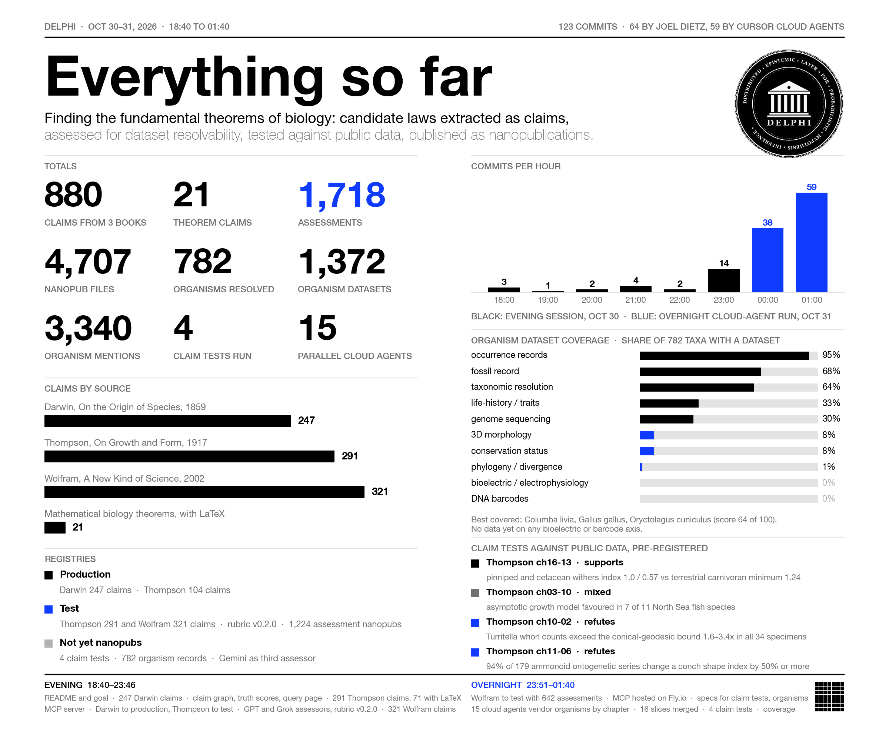
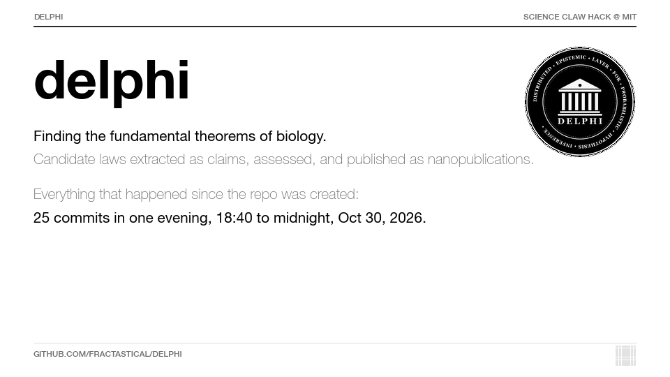
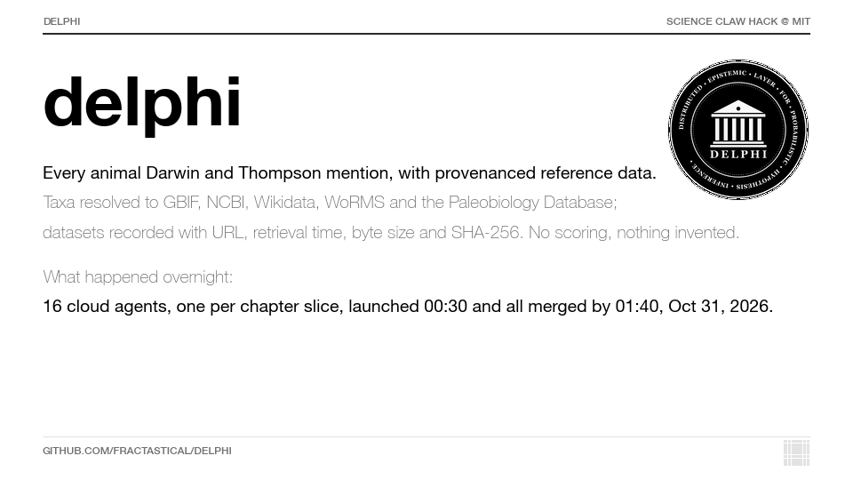
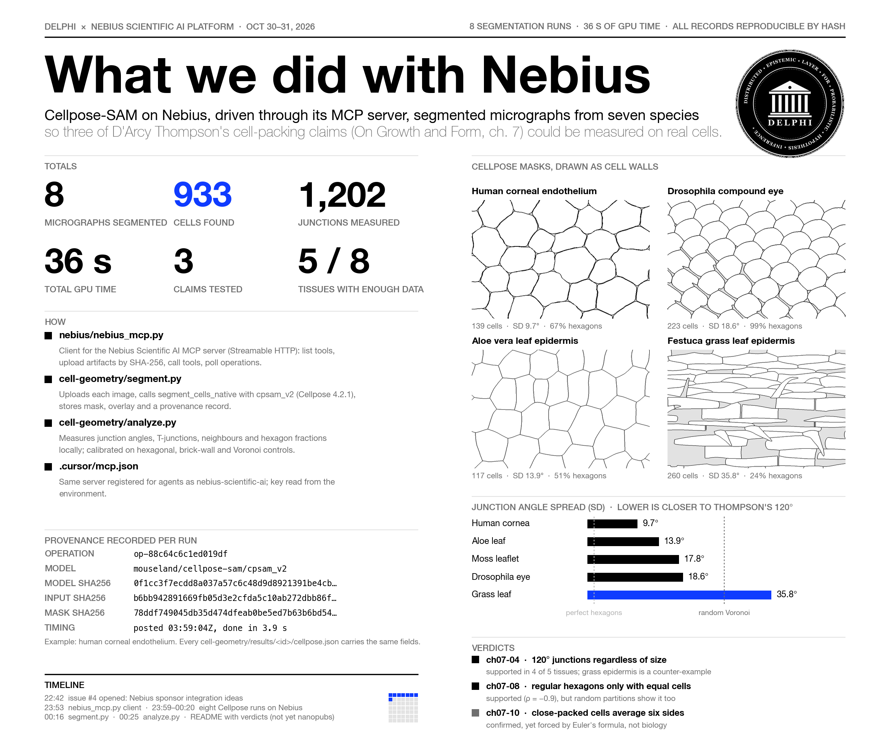

<p align="center">
  
</p>

# delphisci

**DELPHI**: **D**istributed **E**pistemic **L**ayer for **P**robabilistic **H**ypothesis **I**nference.

This project was created for **Science Claw Hack @ MIT**.

## Goal

Our goal is to find the **fundamental theorems of biology**: the general laws that hold across organisms, scales, and systems, stated precisely enough to test.

To get there, we:

- extract candidate laws from the literature as claims, each traced back to its source papers and datasets;
- formalize them where possible, for example as Lean 4 theorems using the ontology's formal-verification terms;
- simulate them across many organisms, not just one model system, since a law that holds in only one organism is not fundamental;
- test them against real empirical data for each organism, and record the evidence and our assessments of it;
- publish each step as a nanopublication, so every candidate law, test, and assessment can be cited, queried, and challenged.

A machine-checked proof shows that a theorem follows from its stated assumptions. It does not show that living systems satisfy those assumptions, which is a question for evidence and experiment. Likewise, each organism's simulation is checked against that organism's own data, not data borrowed from another species.

## Progress at a glance

Illustrated summaries of what has been done so far, regenerated as the project moves. All counts come from the repo itself (git history, `delphi_overview`, `organisms/merged/`, `cell-geometry/results/`).

### Everything so far

Claims, assessments, nanopub files, organisms, claim tests, registries and commits per hour, from the first commit through the overnight run.



### Commit history, animated

One frame per commit of the opening evening (18:40 to midnight, Oct 30, 2026): claims extracted, assessments, nanopub files, and the repo layout filling in.



### Organisms overnight

The parallel cloud-agent run that vendored organism reference data for every chapter of Darwin and Thompson: 782 taxa, 3,340 mentions, 1,372 dataset records, merged in [`organisms/`](organisms/README.md).



### Nebius

Cellpose-SAM on the Nebius Scientific AI Platform segmented micrographs from seven species to test three of Thompson's cell-packing claims; see [`cell-geometry/`](cell-geometry/README.md).



## Approach

This project builds on the Project Delphi ontology and uses [nanopublications](https://nanopub.net/) (nanopubs) as the format for publishing and querying small, citable, machine-readable scientific claims.

## ScienceClaw hackathon work (Oct 31 – Nov 1)

Team roles and deadlines are in [#53](https://github.com/fractastical/delphi/issues/53). This section
covers the genotype–phenotype, validation and MCP-testing work (Amit's row) and the agent threads that
produce it. Everything below is built from repository files by scripts; no figure is typed by hand.

**Start here:** https://delphi-mission-control.ashenoy000.workers.dev/start/ — one page that reads every
thread's status live.

| Page | What it shows |
| --- | --- |
| [Knowledge graph](https://delphi-mission-control.ashenoy000.workers.dev/graph/) | Claims, data tests from both agent swarms, Lean theorems, datasets, taxa, the flying-fish blueprint, open problems and candidate answers, with provenance on every node. `?view=theorems` clusters open problems by the claims their theorems formalise. |
| [Claim Book](https://delphi-mission-control.ashenoy000.workers.dev/proofs/) | Each formalised claim end to end: source, data verdict, the Lean source, the prover's own explanation beside each step, the mutations that had to fail, and the faithfulness verdict. |
| [Figures](https://delphi-mission-control.ashenoy000.workers.dev/figures/) | Every figure with its data source and SHA-256, including the flight phylogeny and gene families. |
| [Deck](https://delphi-mission-control.ashenoy000.workers.dev/deck/) | The running pitch; unevidenced slides are greyed out. A PowerPoint is built from the same data. |
| [Lean](https://delphi-mission-control.ashenoy000.workers.dev/t/lean/) | 53 theorems, zero `sorry`, statement-level mutation testing, the constraint checker and the open-problems elimination ledger. |

**Where things live**

| Path | Contents |
| --- | --- |
| `lean/` | Lean 4 formalisations, `constraints.json`, the candidate checker (`lean/eliminate/`), certificates |
| `claim-tests/` | Pre-registered data tests, A9 faithfulness assessments (`assessment/`), OpenResearch logs |
| `open-problems/` | 215 open problems from named sources, 80 candidate answers, `candidates.formal.json` |
| `organism-design/` | Ontology-grounded blueprints, including the flying fish, and their nanopub drafts |
| `swarm/`, `holdout/` | The four-arm agent comparison and the frozen held-out exam |
| `dashboard/` | The site above and its build scripts; `crosscheck.mjs`, `compliance.mjs`, `make-figures.py` |
| `*/nanopubs/unsigned/` | Validated, **unsigned** nanopub drafts. Nothing has been signed or published (see #37). |

**Agent threads.** The work is split across parallel Claude sessions, each owning one folder and one
sub-dashboard, with rules in [`AGENTS.md`](AGENTS.md) and [`dashboard/THREADS.md`](dashboard/THREADS.md):
claims, lean, holdout, swarm, organism, and new threads for genotype–phenotype mapping, validation and
MCP testing, and visualisation ([`dashboard/NEW-THREADS.md`](dashboard/NEW-THREADS.md)).

**What is not established.** No wet-lab work. No claim promoted to a theorem of biology: a Lean proof
checks the mathematics given its stated assumptions. Flying-fish molecular data comes from proxy species
(medaka, zebrafish) because almost none exists for Exocoetidae itself. The nanopub records are drafts.

## Best practices

Before building, publishing, or querying nanopubs, read [BEST_PRACTICES.md](BEST_PRACTICES.md). It is adapted from the Project Delphi Ontology's publishing guide.

## Related projects

- **Project Delphi Ontology**: [fractastical/project-delphi-ontology](https://github.com/fractastical/project-delphi-ontology)
  - Open pull requests: [project-delphi-ontology/pulls](https://github.com/fractastical/project-delphi-ontology/pulls)

## Querying nanopubs

A nanopublication bundles a single assertion with its provenance and publication info as RDF named graphs. The following resources cover how to find and query them.

To query this project's claims, their math and their assessment rankings, use the `delphisci` MCP server or its CLI in [`mcp/`](mcp/README.md). Agents should start with [AGENTS.md](AGENTS.md), which defines the specialist roles of the claim
pipeline (A1-A13), the inter-agent communication rules, and the shared source of truth. Live team
dashboard: https://delphi-mission-control.ashenoy000.workers.dev/start/

### Web interfaces

- [Nanodash](https://nanodash.knowledgepixels.com/): browse, search, and publish nanopubs in the browser.
- [Nanopub Query](https://query.knowledgepixels.com/): SPARQL endpoints over the nanopub network, including a full repository and per-type and per-pubkey repositories.

### SPARQL

You can send SPARQL queries to the Nanopub Query service. For example, this query lists recent nanopubs with their assertion graphs:

```sparql
PREFIX np: <http://www.nanopub.org/nschema#>
PREFIX dct: <http://purl.org/dc/terms/>

SELECT ?np ?assertion ?created WHERE {
  GRAPH ?head {
    ?np a np:Nanopublication ;
        np:hasAssertion ?assertion .
  }
  OPTIONAL { ?np dct:created ?created . }
}
ORDER BY DESC(?created)
LIMIT 20
```

See the [nanopub-query repository](https://github.com/knowledgepixels/nanopub-query) for available endpoints and usage details.

### Libraries and tooling

- [nanopub-py](https://github.com/fair-workflows/nanopub): Python library for searching, fetching, and publishing nanopubs.
- [nanopub-java](https://github.com/Nanopublication/nanopub-java): Java library and CLI.
- [Nanopub registry](https://github.com/knowledgepixels/nanopub-registry): the decentralized registry that stores and serves nanopubs.

### Background

- [nanopub.net](https://nanopub.net/): overview of the nanopublication model and ecosystem.
- [Nanopublication guidelines](https://nanopub.net/guidelines/working_draft/): the formal specification.
