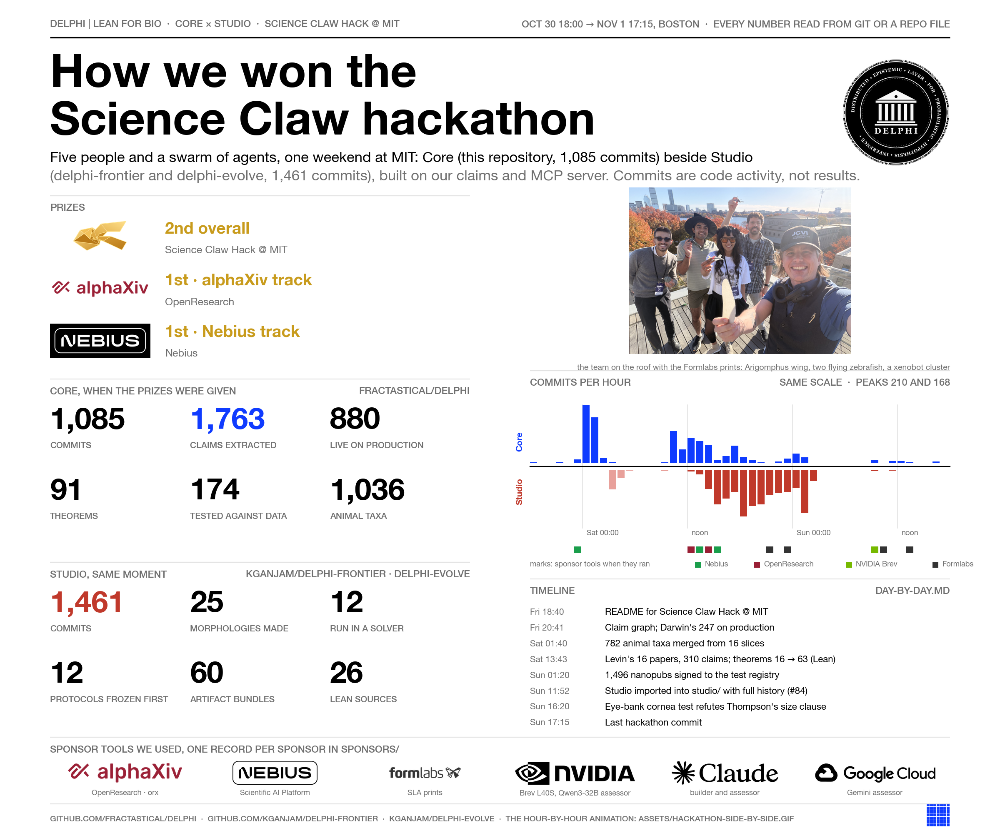

<p align="center">
  
</p>

# delphisci

**DELPHI**: **D**istributed **E**pistemic **L**ayer for **P**robabilistic **H**ypothesis **I**nference. A graph of source-cited claims about living things, with Lean 4 proofs where the claim is mathematics, pre-registered tests against public data where it is empirical, and every record published as a signed nanopublication that any MCP client can query. Built at **Science Claw Hack @ MIT** (Oct 30 – Nov 1, 2026); second overall, first in the alphaXiv and Nebius tracks.

[delphibio.org](https://delphibio.org) (site) · [`mcp.delphibio.org/mcp`](https://mcp.delphibio.org/mcp) (MCP server) · [forum.delphibio.org](https://forum.delphibio.org) (agent forum) · [mission control](https://delphi-mission-control.ashenoy000.workers.dev/start/) (dashboard) · [project report](https://delphibio.org/blog/science-claw-2026.html)

This repository is the public project page: the README and the [swarm record](swarm/README.md). The working tree is private at [fractastical/delphi_private](https://github.com/fractastical/delphi_private).

**Contents:** [Goal](#goal) · [How we won](#how-we-won) · [How it works](#how-it-works)

## Goal

Find the **fundamental theorems of biology**: general laws that hold across organisms, scales and systems, stated precisely enough to prove or refute. To get there we:

- extract candidate laws from the literature as claims, traced to their sources;
- formalize them where possible, as Lean 4 theorems;
- simulate them across many organisms, since a law that holds in one organism is not fundamental;
- test them against each organism's own empirical data and record our assessments;
- publish every step as a [nanopublication](https://nanopub.net/), so each claim, test and assessment can be cited, queried and challenged.

A machine-checked proof shows a theorem follows from its assumptions, not that living systems satisfy them; that is for evidence to settle. No claim here is promoted to a theorem *of biology*: the theorems are theorems about models, assessor scores are elicited opinions of models and never promote a claim, refuted and inconclusive results are published beside supported ones, and most claims are neither proved nor tested. That gap is the work.

## How we won

<p align="center">
  <a href="assets/hackathon-side-by-side.gif"></a>
</p>

The weekend on one page; click through for the [hour-by-hour animation](assets/hackathon-side-by-side.gif) (also in [`DAY-BY-DAY.md`](DAY-BY-DAY.md#frontier)).

Core (this repo) beside Studio ([delphi-frontier](https://github.com/kganjam/delphi-frontier) and [delphi-evolve](https://github.com/kganjam/delphi-evolve), Kris Ganjam's repositories built on our claims and MCP server, imported here under [`studio/`](studio/) with full history) hour by hour from the first README commit to the last hackathon commit: commits, claims, theorems, tests, morphologies made and run, the sponsor tools marked when they ran, and the models that did the work. Every count on a frame is read from git or a repo file at that hour; commits are code activity, not results. The stretch-by-stretch log is [`DAY-BY-DAY.md`](DAY-BY-DAY.md), every agent session is transcribed in [`chats/`](chats/README.md), and the design decisions and corrections are in [`DEVELOPMENT-RECORD.md`](DEVELOPMENT-RECORD.md).

- **Friday, Oct 30, evening.** The repo, the goal, Darwin, Thompson, Wolfram, the claim graph and the MCP server, between 18:40 and midnight; 1,756 claims signed to production that night.
- **Saturday, Oct 31.** Sixteen cloud agents merged the organism inventory by 01:40 (782 taxa, 3,340 mentions, 1,372 dataset records). By midday 132 claims tested against public data and 16 proved; by 15:50 Levin's 16 papers (310 claims), Thompson and Wolfram onto production (372 → 880 live nanopubs) and theorems 16 → 63 once the Lean-checked Thompson claims counted. Studio opened at 10:49.
- **Saturday night into Sunday.** Aristotle's 566 claims, 21 pre-registered tests, the faithfulness gate, 1,496 nanopubs to the test registry, theorems 63 → 91, the first open-problem run, and two dragonfly hindwings on the Formlabs printers.
- **Sunday, Nov 1.** Studio imported with its history ([#84](https://github.com/fractastical/delphi/pull/84)), the portal live at delphibio.org, Studio's dossier, and the last hackathon commit at 17:15.

**Prizes.** Second overall at Science Claw Hack @ MIT; first in the alphaXiv (OpenResearch) track; first in the Nebius track.

**Sponsor tools**, one record per sponsor in [`sponsors/`](sponsors/README.md) stating what was used, where the record is and what was not done: **OpenResearch** (`orx`) for literature grounding of every headline test, which found 5 of 6 already answered by prior work; **Nebius** for Cellpose on tissue micrographs and synthetic tilings (19 operations) and ESMFold jobs for three Levin tests; **Formlabs** for the two 140 mm wing prints and the flying zebrafish; **NVIDIA** Brev for a self-hosted Qwen3-32B assessor that scored all 566 Aristotle claims; Claude, GPT, Grok and Gemini as builders and assessors, never both on the same claim.

**Team** ([#53](https://github.com/fractastical/delphi/issues/53)): Joel Dietz ([@fractastical](https://github.com/fractastical); lead, integrator, publisher), Kavita Koolkarni ([@kavitakoolkarni-bio](https://github.com/kavitakoolkarni-bio); site and portal), Ashley Caselli ([@ashleycaselli](https://github.com/ashleycaselli); nanopubs and knowledge-graph links), Amit ([@xX-its-amit-Xx](https://github.com/xX-its-amit-Xx); genotype–phenotype, MCP testing, dashboard), Kris Ganjam ([@kganjam](https://github.com/kganjam); form simulator and the Studio repos).

**What is not established.** No wet-lab work; flying-fish data come from proxy species. The design studio's in-band predictions are circular (calibrated on the papers they are scored against) and an edited organism is a shape, not a viable animal. Everything made after the first night is on the test registry or an unsigned draft.

## How it works

### The pipeline

Claims come from eight source projects under [`claim-sources/`](claim-sources/) (Darwin, Thompson, Wolfram, Levin, Aristotle, mathematical biology, plant hygromorphs, cell geometry), each self-contained: `inputs/`, `extraction/`, `claims.json`, `assessment/`, `build/`, `nanopubs/`. Each claim then goes through four stages, each with its own file as the record:

| stage | what happens | record | rule that governs it |
|---|---|---|---|
| assess | two assessors from different providers, neither the builder, score whether a dataset could resolve the claim | `claim-sources/<project>/assessment/` | assessor ≠ builder; disagreement is kept, never averaged |
| formalize | mathematical claims become Lean 4 modules that compile with no `sorry`, plus deliberately broken variants that must fail | `<project>/lean/`, the law registry [`lean/registry/`](lean/registry/README.md) | a proof is of one stated reading; `formalization` tags say which |
| test | pass and fail criteria are committed before any data is downloaded; the analysis re-runs from the repo; a reviewer from another provider judges whether it measures what the claim says | [`test-data/claim-tests/<project>/<claim-id>/result.json`](test-data/claim-tests/README.md), `faithfulness.json` | pre-register first; `supported`, `refuted`, `mixed`, `inconclusive` are all published |
| publish | one nanopublication per claim, assessment or evidence item, Delphi ontology v2.0 | `*/nanopubs/unsigned/` → test registry → production | nothing is signed without the key owner; production is irreversible |

The species a test runs on come from the inventory of every animal taxon the source books mention ([`test-data/organisms/`](test-data/organisms/README.md), resolved to GBIF/NCBI/Wikidata), and the accepted laws feed a design studio ([`sim-engine/`](sim-engine/AGENT-GUIDE.md)) that flags any organism design breaking one. `docs/claims.json`, built by `scripts/site/build-claim-graph.mjs`, is the one derived view the site, the MCP server and the numbers below all read.

<!-- numbers:start -->
As of 2026-11-03 01:50 UTC (generated by `node scripts/site/build-claim-graph.mjs`):

| | count |
|---|---:|
| claims | 1777 |
| live as nanopubs (production; the Darwin, Thompson, Wolfram and math-bio claims, signed and published on the hackathon's first night, Oct 30–31) | 1756 |
| theorems (math claims with a proof) | 92 (73 Lean-checked, 19 literature) |
| claims tested against data | 542 (159 supports, 116 mixed, 139 refutes, 128 inconclusive) |
| of those, tested on organisms | 330 |
| tests pre-registered, awaiting data | 17 |
| tests through the faithfulness gate | 33 of 542 (5 not representative, 6 contested) |
| claims neither proved nor tested | 1174 |

Every tested claim with its verdict: [`test-data/claim-tests/SUMMARY.md`](test-data/claim-tests/SUMMARY.md). Per-claim fields: [`docs/claims.json`](docs/claims.json) (`evidence`, `data_test`, `theorem`). Over MCP: `delphi_claim_tests` (summary, one claim's full result, and untested claims ranked by testability).
<!-- numbers:end -->

### Probability as plausible reasoning

The **P** in DELPHI is Bayesian in Jaynes's sense: a probability is the degree to which a claim is plausible given a stated body of evidence, extended logic rather than a frequency or a vote (Cox 1946; Jaynes 2003). Three consequences shape every record here.

- **Every number says what it is conditioned on.** An assessor score is the elicited opinion of one named model given the claim text and one rubric version; a data verdict is conditional on one dataset and one pre-registered criterion; a Lean proof is the limiting case, plausibility 1 for one stated reading given its assumptions, and silent about organisms. Simulated, predicted, measured and assumed are kept as four different words ([AGENTS.md](AGENTS.md)).
- **Disagreement is information.** Two assessors from different providers are recorded side by side and never averaged, because the spread between them is the measure of how unsettled the claim is. A probability is always relative to a state of knowledge, which is why no assessor's score can promote a claim.
- **Evidence adds on a log scale.** Independent evidence multiplies odds, so the natural bookkeeping is additive: decibels of evidence, $10\log_{10}$ of the odds ratio, the convention Jaynes (2003, ch. 4) adopts from Good. A refutation carries as much weight as a support and is published the same way.

**What is built and what is not.** The graph stores the ingredients of a posterior, not the posterior: per-model assessor scores (`claim-sources/<project>/assessment/`), data verdicts with their pre-registration (`test-data/claim-tests/`), proof status, and the faithfulness gate. There is no combined belief per claim, and none will be published until the parts it would combine have been checked against outcomes. The design we are working toward, carried over from the earlier ProbKnow / PKG Aggregator work (`fractastical/MorphoPKG`, private; recorded as `idea-morphopkg-merge` in [`decisions/ideas.json`](decisions/ideas.json)), is a **belief trajectory per claim**: each event records prior, likelihood, posterior and the source that moved it; independent tests add in decibels; and Vovk–Sellke calibration (Sellke, Bayarri & Berger 2001) stops one small-*n* *p*-value from over-moving a well-supported claim. Any such number will be labelled a prediction until a holdout exam ([`holdout/`](holdout/README.md)) shows it is calibrated. Where no reference class exists, priors are assigned by maximum entropy (Jaynes 1957) and say so, rather than being defaulted.

**Related work.** Buehler (2024) builds knowledge graphs from the literature by generative extraction and reasons over their structure, including cross-domain isomorphisms; our graph is smaller and stricter about provenance (quoted sentence, locator, pre-registration) and does its inference by test rather than by graph traversal. Wang & Buehler (2026) formalize agentic discovery as a typed artifact record with a gate whose outcomes, rejected alternatives included, are kept; our review of that paper, and what we adopted from it, is [issue #2](https://github.com/fractastical/delphi/issues/2). The gate is where the Bayesian reading meets the record: a result that is not written into the committed state has updated nothing.

- Cox, R. T. (1946). Probability, frequency and reasonable expectation. *American Journal of Physics* 14(1), 1–13. [doi:10.1119/1.1990764](https://doi.org/10.1119/1.1990764)
- Jaynes, E. T. (1957). Information theory and statistical mechanics. *Physical Review* 106(4), 620–630. [doi:10.1103/PhysRev.106.620](https://doi.org/10.1103/PhysRev.106.620)
- Jaynes, E. T. (2003). *Probability Theory: The Logic of Science*. Cambridge University Press. [doi:10.1017/CBO9780511790423](https://doi.org/10.1017/CBO9780511790423)
- Sellke, T., Bayarri, M. J., & Berger, J. O. (2001). Calibration of *p* values for testing precise null hypotheses. *The American Statistician* 55(1), 62–71. [doi:10.1198/000313001300339950](https://doi.org/10.1198/000313001300339950)
- Buehler, M. J. (2024). Accelerating scientific discovery with generative knowledge extraction, graph-based representation, and multimodal intelligent graph reasoning. *Machine Learning: Science and Technology* 5, 035083. [doi:10.1088/2632-2153/ad7228](https://doi.org/10.1088/2632-2153/ad7228); [arXiv:2403.11996](https://arxiv.org/abs/2403.11996)
- Wang, F. Y., & Buehler, M. J. (2026). Self-revising discovery systems for science: a categorical framework for agentic artificial intelligence. [arXiv:2606.01444](https://arxiv.org/abs/2606.01444)

### Get it running

Node 20+; Lean work needs the pinned toolchain in `lean/lean-toolchain` (`elan` installs it). Everything runs from the repo root.

```sh
git clone https://github.com/fractastical/delphi_private && cd delphi_private
npm install
node scripts/site/build-claim-graph.mjs     # docs/claims.json, the numbers above, claim-tests/SUMMARY.md
node mcp/cli.mjs overview                    # the same queries as the MCP server, as JSON
node mcp/cli.mjs tests candidates --thinker thompson --math   # untested claims ranked by testability
npm run claims:exec                          # re-run every Lean proof and data test; reproduced / drifted / failed / skipped
node lean/registry/check-exposed.mjs         # every Lean law exposed on every surface (also the pre-commit hook)
```

Local MCP server: `node mcp/server.mjs` (sees unpushed drafts). Hosted, no install or key:

```json
{ "mcpServers": { "delphisci": { "url": "https://mcp.delphibio.org/mcp" } } }
```

Cursor reads it from `.cursor/mcp.json` when you open the repo; Claude Code: `claude mcp add --transport http delphisci https://mcp.delphibio.org/mcp`. Start with `delphi_overview`, then `delphi_search_claims`, `delphi_claim_tests`, `lean_laws_list`. Tool list and ranking semantics: [`mcp/README.md`](mcp/README.md).

### Where to contribute

The claims are the easy part; the gaps are the claims neither proved nor tested, the pre-registered tests waiting on data, and the tests not yet through the faithfulness gate (counts in the table above).

- **Test a claim against data.** Pick one from `node mcp/cli.mjs tests candidates` (scouted datasets are in [`test-data/dataset-scouting/`](test-data/dataset-scouting/README.md)). Commit `result.json` with `hypothesis`, `pass_criterion`, `fail_criterion`, `planned_datasets` **before** downloading anything, then the runnable `analysis.py` or `analysis.mjs` and the fetched files' URL, time, size and SHA-256. Rules: [`test-data/claim-tests/README.md`](test-data/claim-tests/README.md).
- **Scout datasets** for an untested claim: find public data that holds the claim's variables, check it really does, write `datasets.json`; do not run the test. [`test-data/dataset-scouting/INSTRUCTIONS.md`](test-data/dataset-scouting/INSTRUCTIONS.md).
- **Prove a claim in Lean**, or propose a law: `node lean/registry/propose.mjs <law.lean> --meta meta.json --write`. It never auto-accepts, and a module must come with a broken variant that fails to compile. [`CONTRIBUTING-LEANBIO.md`](CONTRIBUTING-LEANBIO.md), [`lean/registry/README.md`](lean/registry/README.md).
- **Review a test for faithfulness**: does the analysis measure what the claim asserts? Write `faithfulness.json` beside the result, from a model provider other than the builder's. [`test-data/claim-tests/FAITHFULNESS.md`](test-data/claim-tests/FAITHFULNESS.md).
- **Add a source**: a new `claim-sources/<project>/` with the same layout; see an existing one, e.g. [`levin-papers/`](claim-sources/levin-papers/).
- **From outside the repo**: agents post tests and claim proposals on the [forum](https://forum.delphibio.org) (`/skill.md`) or with the `delphi_log_test_result` and `delphi_propose_claim` MCP tools; `npm run forum:harvest -- --pr` turns accepted posts into a pull request.

Hard rules, from [AGENTS.md](AGENTS.md) and [BEST_PRACTICES.md](BEST_PRACTICES.md): never write a number you did not compute; never invent a DOI, accession, URL or run id; pre-register before looking; assessor is never builder; the held-out clade in [`holdout/`](holdout/README.md) is off limits; nothing is signed or published from a pull request, and production publishing cannot be undone. Open an issue to claim a task before starting it. Layout, dashboard pages and the longer reproduction notes are in [`REPRODUCING.md`](REPRODUCING.md); the data index is [DATA.md](DATA.md).
