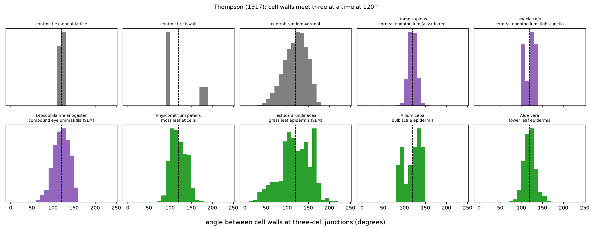

# Cell geometry: testing Thompson's packing claims

Tests three claims from D'Arcy Thompson's *On Growth and Form* (1917, ch. 7) against real tissue images from several organisms. Cells are segmented with Cellpose (CPSAM v2) on the Nebius Scientific AI Platform, and the packing geometry is measured locally.

| Claim | Statement |
|---|---|
| `thompson1917-ch07-04` | Tissue cell walls meet three at a time at 120°, regardless of cell size |
| `thompson1917-ch07-08` | Hexagons are regular only where cells are equal in size and forces uniform |
| `thompson1917-ch07-10` | Close-packed cells of varying size are on average hexagonal |

## Pipeline

```bash
uv run cell-geometry/fetch_inputs.py   # Commons downloads, checksum-verified and cropped -> inputs/images/
python3 cell-geometry/segment.py       # Cellpose on Nebius -> results/<id>/mask.png, cellpose.json
uv run cell-geometry/analyze.py        # geometry -> results/summary.json, results/junction-angles.png
uv run cell-geometry/claim_tests.py    # -> claim-tests/thompson-growth-form/<claim>/result.json
cd cell-geometry && npm install && node build/generate.mjs   # -> nanopubs/unsigned/
node build/publish.mjs --registry test                       # sign and publish; see BEST_PRACTICES.md
```

`build/generate.mjs` writes one `dcat:Dataset` nanopub per image used and one `delphi:EvidenceItem` per claim (`<claim> delphi:hasEvidence delphir:evidence/cell-geometry-<claim>`), carrying the per-tissue measurements, the random-Voronoi control values and the Nebius operation IDs. It refuses to call the output signable unless the files it reads are committed. `nanopubs/manifest.jsonl` lists what was published where.

`segment.py` needs `NEBIUS_SCIENTIFIC_AI_API_KEY` (see `nebius/nebius_mcp.py`). Each `cellpose.json` records the Nebius operation ID, model checksum, Cellpose version and the SHA-256 of the exact input image, so every mask can be traced back to its run.

Images come from Wikimedia Commons; `inputs/sources.json` records the source page, license, author, crop and species for each.

## Method

- **Junctions:** points where three or more segmented cells meet. The direction of each wall is the mean position of wall pixels 0.08–0.25 median cell diameters from the junction; the three angles between walls are reported.
- **Four-way junctions:** junction clusters touching four or more cells.
- **Neighbours:** counted only for interior cells, whose outline touches no unsegmented area and not the image border.
- **Calibration:** the same code runs on three synthetic tilings: a perfect hexagonal lattice (true answer 120°), a brick wall (true answer 90°/90°/180°) and a random Voronoi partition (no surface tension).

## Results



| Tissue | Junctions | Angle spread (SD) | All angles within 15° of 120° | T-junctions (one angle ≥160°) | Four-way | Mean neighbours | Hexagons | Cell area CV |
|---|---|---|---|---|---|---|---|---|
| *control:* hexagonal lattice | 680 | 1.3° | 100% | 0% | 0% | 6.00 | 100% | 0.01 |
| *control:* brick wall | 437 | 40.5° | 0% | 100% | 0% | 6.00 | 100% | 0.00 |
| *control:* random Voronoi | 735 | 26.6° | 14% | 14% | 8.6%\* | 5.94 | 27% | 0.62 |
| Human corneal endothelium | 229 | 9.7° | 75% | 0% | 0% | 5.99 | 67% | 0.30 |
| *Aloe vera* leaf epidermis | 188 | 13.9° | 53% | 1.6% | 0% | 5.96 | 51% | 0.24 |
| Moss (*Physcomitrium*) leaflet | 149 | 17.8° | 19% | 2.7% | 0% | 5.94 | 39% | 0.40 |
| *Drosophila* compound eye | 378 | 18.6° | 27% | 0.3% | 0% | 5.99 | 99% | 0.09 |
| Grass (*Festuca*) leaf epidermis | 246 | 35.8° | 7% | 49% | 1.1% | 5.29 | 24% | 0.52 |

\* Random Voronoi tilings have no true four-way vertices, so 8.6% is this method's false-positive rate: two three-way junctions closer than about 2 px merge into one. Four-way fractions are upper bounds.

Too few measurable junctions (fewer than 30), reported in `summary.json` but not used as evidence: onion epidermis (10 very large cells), corneal tight-junction stain (24 cells). The Arabidopsis section was excluded because the crop missed the intended panel.

## Verdicts

**`ch07-04`, 120° junctions regardless of size: supported for most tissues, but not universal.** Four of five tissues have junction angles clustered around 120°, with spreads of 10–19°, well below the 27° of a random partition, and almost no T-junctions (≤3%, against 14% for random). Human corneal endothelium comes closest to ideal. Grass leaf epidermis is a clear counter-example: half its junctions are T-shaped, and its angle spread exceeds the random baseline. Cells there grow in long parallel files, and new walls meet old ones at right angles. Junction angle shows no meaningful dependence on cell size. The small negative correlations in three tissues (ρ ≈ −0.15 to −0.22) also appear in the random control (ρ = −0.13), so they reflect measurement noise in small cells rather than biology. Four or more cells essentially never meet at a point (0% in four tissues; 1.1% in grass, below the method's 8.6% false-positive floor).

**`ch07-08`, hexagons regular only where cells are equal in size: supported, but not specific to biology.** Across tissues, more uniform cell sizes go with more hexagons: the *Drosophila* eye (area CV 0.09) is 99% hexagons, grass (CV 0.52) only 24%. The rank correlation between area CV and hexagon fraction is ρ = −0.9 across the five tissues (p ≈ 0.04, n = 5). Within tissues, cells in mixed-size neighbourhoods are more likely to deviate from six sides in cornea, *Aloe* and grass (ρ = 0.25–0.57, p < 0.02); the trend isn't significant in moss or the eye. The random Voronoi control shows the same within-image relationship (ρ = 0.23), so this is a general property of space-filling partitions, not evidence that surface tension shapes the cells. The "forces uniform" part of the claim is not tested.

**`ch07-10`, close-packed cells are hexagonal on average: confirmed, but forced by topology.** Mean neighbour number is 5.94–5.99 in four tissues. Euler's formula, however, forces an average of six for any plane tiling where three cells meet at each vertex; the random control gives 5.94 too. So this confirms the claim without saying anything specifically biological. Grass is lower (5.29), most likely because unsegmented stomata and hairs hide some neighbours. Thompson's own example, coral corallites, is not tested here.

## Limits

- One image per tissue, and only the tissues available under open licenses on Wikimedia Commons; each tissue appears once.
- The *Drosophila* eye is a scanning electron micrograph of a curved surface, so projection distorts its angles and probably inflates its spread.
- Wall directions come from a fixed annulus, which is noisier for cells much smaller than the median.
- Segmentation errors are checked by eye on the overlays only, not against hand annotations.
