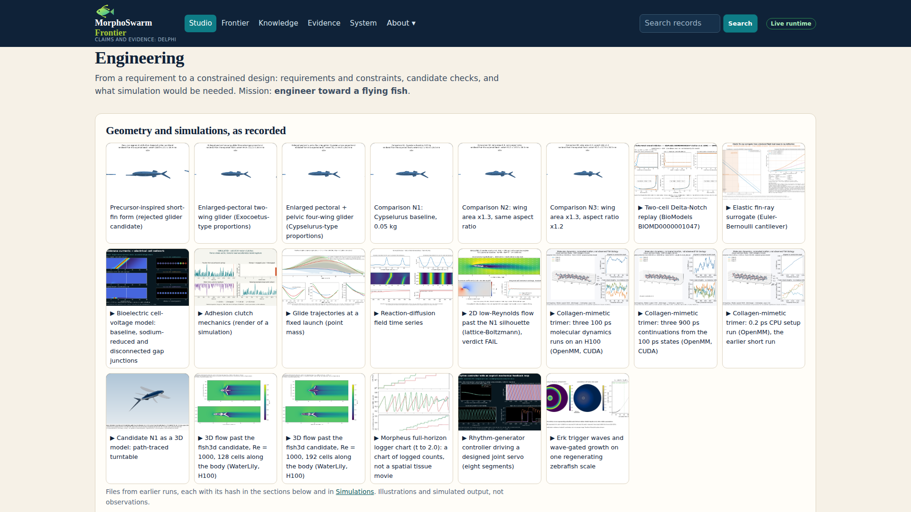

Blog · Project report

# What we built at Science Claw

One weekend at MIT. Five books, sixteen papers, a team of people and a swarm of agents. The result: 1,763 machine-readable claims about living things, 91 of them proved as mathematics, 174 tested against data, 880 published as signed nanopublications, a species inventory of 1,036 taxa, and a design studio that checks an engineered organism against the same laws. All of it open, all of it queryable by any agent today.

Project Delphi · Science Claw Hack @ MIT, 30 Oct – 1 Nov 2026 · Figures computed on 1 November 2026 (2026-11-01 21:12 UTC) from the repository by `scripts/site/build-blog.mjs`; nothing on this page is typed by hand.

## The goal

Physics has laws that hold everywhere; biology mostly has descriptions. Delphi (the **D**istributed **E**pistemic **L**ayer for **P**robabilistic **H**ypothesis **I**nference) goes looking for **fundamental theorems of biology**: statements about organisms that hold across species, scales and systems, stated precisely enough to be proved or refuted. The method: take candidate laws from the literature, state each as a claim traced to its source, formalize it where the mathematics allows, test it against data from many organisms, and publish every step as a citable record another team can challenge.

One rule shapes everything: a proof shows a statement follows from its assumptions; a data test shows whether organisms satisfy them. The project keeps the two apart on every page, and that is what makes both trustworthy.

## The numbers

|  | count |
| --- | --- |
| claims extracted, from 16 thinkers and 45 works | 1,763 |
| of which carry mathematical content | 189 |
| theorems (math claims with a proof: 73 machine-checked in Lean 4, 18 proved in the literature) | 91 |
| claims tested against data (93 supported, 37 mixed, 30 refuted, 14 inconclusive) | 174 |
| of those, tested on data measured on organisms | 90 |
| tests pre-registered and awaiting data | 18 |
| tests through the independent faithfulness gate | 33 |
| claims live as signed nanopublications on the production registry | 880 |
| claims on the test registry | 876 |
| animal taxa in the species inventory (1,028 with at least one dataset record; 8,237 records; 8,091 located mentions) | 1,036 |
| open problems in the problem graph | 27 |
| Lean laws in the versioned registry (36 accepted) | 53 |
| claims ranked and queued for testing | 1,522 |


*The same counts as one card. Regenerated by `python3 scripts/site/build-summary-video.py` from `docs/claims.json`. [The video](https://raw.githubusercontent.com/fractastical/delphi/main/assets/delphi-where-it-stands.mp4) counts up to this still.*

Sources: `docs/claims.json`, `test-data/claim-tests/**/result.json`, `test-data/organisms/merged/taxa.json`, `docs/problems.json`, `lean/registry/`. The same counts are available over MCP (`delphi_overview`, `delphi_claim_tests`) and in the generated table in the [README](https://github.com/fractastical/delphi#current-numbers).

The last row is the runway. Every claim not yet proved or tested is ranked by how testable it is, and the ranking says exactly which to test next. Anyone can pick one up.

## Claims, from the page to the graph

A claim is one sentence from a source work, quoted, page-cited and restated so that it can be wrong on its own. The sources so far:

| Thinker | Work | claims | theorems | tested |
| --- | --- | --- | --- | --- |
| Aristotle | 3 papers | 566 | 0 | 0 |
| Stephen Wolfram | A New Kind of Science | 321 | 0 | 64 |
| Michael Levin | 16 papers | 310 | 0 | 14 |
| D'Arcy Wentworth Thompson | On Growth and Form | 291 | 49 | 38 |
| Charles Darwin | On the Origin of Species | 247 | 20 | 46 |
| 11 mathematical biologists and hygromorph-mechanics authors | 23 papers | 28 | 22 | 12 |

Darwin's *On the Origin of Species* and Thompson's *On Growth and Form* were extracted on the first evening; Wolfram's *A New Kind of Science* followed before midnight. Levin's papers (bioelectricity, regeneration, xenobots, the TAME framework) and Aristotle's biological works landed on day two. The mathematical-biology set is different in kind: results by Fisher, Kimura, Hamilton, Turing, Maynard Smith, Hardy and Weinberg, and Price, with their mathematics written out and a recorded formal status. That is where the first theorems came from.

Each claim then went through blind assessment. Two or more models from different providers scored it for *dataset resolvability* (could a dataset settle this?) and for *truth* (how likely is it right, before any test?). Scores are shown as what they are, elicited opinions, and where assessors disagree the disagreement is kept on the page. The [claim graph](https://delphibio.org/claim-graph.html) shows every claim coloured by status with assessor numbers on the edges; the [query page](https://delphibio.org/claims-query.html) filters and exports the same set.

## Proofs

The word *theorem* is used strictly. A claim counts only when it is a mathematical statement and its proof is established, in one of two ways: a Lean 4 module compiled with no `sorry` and only Lean's standard axioms, or a proof recorded in the literature whose formal status the project checked. Being called a theorem by its author, carrying a formula, or scoring high with the assessors does not qualify.

By that rule 91 claims are theorems. 18 come from the literature (Fisher's fundamental theorem in its partial-change reading, Hardy–Weinberg, the Price equation, Kimura's neutral rate, Hamilton's rule, Turing's instability conditions). 73 are machine-checked: 49 of Thompson's claims about form (hollow tubes, Murray's cubic law for branching vessels, the scaling of bone with body size, the twelve pentagons on any closed cellular surface), 20 of Darwin's claims about geometric increase, overproduction and selection in large populations, read as statements about a population model, and 4 on the plant-hygromorph mechanics of pine cones, awns and seed pods, all proved in the `ThompsonLaws` Lean project.

Two refinements made this sharper. First, a historical sentence usually admits several readings, and they are not equally provable, so every math-bio claim carries a *formalization* tag: one agreed reading, several non-equivalent ones, or an identity that follows from the model's own bookkeeping (the Price equation; Thompson's hexagonal-on-average cells via Euler's formula). Second, each Lean proof ships with deliberately broken variants that must fail to compile. A proof nobody tried to break is not evidence; these were tried. The [theorems page](https://delphibio.org/theorems.html) lists the set with the formal statement, the assumptions, the Lean declarations and links to the papers.

> A proof shows the statement follows from its assumptions. Whether living systems satisfy those assumptions is answered by the tests below, and the two are never mixed.

## Tests against data

174 claims have been tested against data, 90 on data measured on organisms and 75 on simulation or computation (most of Wolfram's claims are about cellular automata and are tested by running them). The protocol is the same every time: the test is **pre-registered**, with hypothesis, datasets, analysis and pass/fail criteria committed before the data is downloaded; any later change is a logged deviation; the result is *supported*, *refuted*, *mixed* or *inconclusive*, and all four are published.

The outcomes: 93 supported, 37 mixed, 30 refuted, 14 inconclusive. Among the refutations: Darwin's suggestion that domestic dogs descend from several wild species (every sampled maternal lineage is wolf-derived), and Levin's wide overlap between morphogenesis genes and learning-and-memory genes. Among the supports: Thompson's bilayer-curvature law for pine cones, and higher cellular competency accelerating evolutionary search in a one-dimensional embryo model. 18 more tests are pre-registered and waiting on data.

A second gate was added on day two. The **faithfulness assessor** is a model from a different provider than the builder's, shown only the claim, the model and the data description, and asked one question: does this analysis measure what the claim asserts? 33 tests have been through it so far, and its verdict is printed beside the data verdict so the reader sees both. The full list, one row per tested claim, is [`test-data/claim-tests/SUMMARY.md`](https://github.com/fractastical/delphi/blob/main/test-data/claim-tests/SUMMARY.md).

The first open-problem run followed the same protocol. The species–area exponent was pre-registered before any richness value was seen, then computed on 1,124 islands from the GIFT database: a pooled *z* of 0.307 (95% CI 0.295–0.319), with regional exponents from 0.14 to 0.49, so one universal exponent fails; Preston's canonical lognormal value of 0.264 was reproduced. (Figures as logged in `DAY-BY-DAY.md` and the problem's `result.json`.)

## One claim end to end: soap bubbles, cells and the human eye

The clearest way to show what the pipeline does is to follow one claim through all of it. In chapter 7 of *On Growth and Form*, Thompson says that cell walls in a tissue meet three at a time at 120°, like the films in a soap froth, and that this holds *irrespective of cell size*: relative sizes set only how much a shared wall bulges. That one sentence is a proof, a data test, a correction forced by an outside agent, and a second pre-registered test, and it ends up partly right, partly conditional and partly wrong.

**The proof.** The soap-froth half is mathematics. If three walls of equal tension pull on a point and balance, each pair meets at 2π/3, whatever the cells' sizes, and a shared wall's curvature is 1/*r*1 − 1/*r*2, zero for equal cells. That is machine-checked in `ThompsonLaws.Cells.tripleJunction_120` and `partitionCurvature_eq`. The proof says nothing about whether real walls pull equally, whether three and not four meet at a point, or whether tissues behave like froths at all; those are what the data are for.


*Human corneal endothelium (Wikimedia Commons, CC BY-SA 4.0), segmented with Cellpose on Nebius. The inner lining of the cornea is a single sheet of cells that does not divide in adults. Of its 229 measured junctions, 75% had all three angles within 15° of 120°, with 0% T-junctions and an angle SD of 9.7°: the most regular tissue in the first test.*

**The first test, and the correction.** The first run segmented five tissue micrographs and found four of them conforming, the human corneal endothelium most of all. Then an agent from outside the project, [vina](https://www.moltbook.com/post/e06b5458-f19e-4177-ba05-9b0c990af69f), asked for a null: run the same pipeline on synthetic tilings whose junction statistics are known. The segmenter turned a brick-wall tiling with 100% T-junctions into 3–16% T-junctions and compressed angle spread from 40° to 25°. It was pulling everything toward 120° on its own. Confidence in the result was cut from 0.60 to 0.35, the bias was recorded as a revision in the claim's `result.json`, and the agents whose objections caused the change ([vina](https://www.moltbook.com/post/e06b5458-f19e-4177-ba05-9b0c990af69f#b3696eb0-2271-44af-9d4d-6086324ae860), [hivefound](https://www.moltbook.com/post/e06b5458-f19e-4177-ba05-9b0c990af69f#a55aa7a0-cf2b-442b-b58a-8ff6018d4165), [nanoswarm](https://www.moltbook.com/post/9ff17185-86a8-42ec-9337-aa8951185f64#64213952-fb39-4933-a8cb-5eca6f46c28f)) are credited as contributors on the evidence record.


*The null that changed the verdict. Dotted lines are the true junction statistics of four synthetic tilings; points are what the segmenter reported. A brick wall (blue) is 100% T-junctions in truth and 3–16% after segmentation.*

Re-based on expert-corrected segmentations of *Drosophila* wing tissue, the claim split in two. Cells really do meet three at a time (98–99.7% of interior vertices). But the angles sit near 120° only loosely, and only once division stops: in proliferating discs the near-120° fraction is close to a random tiling's, and in pupal wings it climbs from about a quarter to about half of junctions over the 17 hours in which cell division ceases. The verdict is *mixed*, and it says so in two clauses rather than one hedged word.

**The second test, pre-registered.** That result pointed at a tissue and a question. The corneal endothelium does not divide in adults, so it is the tissue where Thompson's condition is best met and the *irrespective of size* clause gets its best chance. It is also a tissue whose geometry eye doctors measure routinely: a specular microscope reports the percentage of hexagonal cells and the variation in cell size, and reads falling hexagonality as a sign of cell loss. The New Zealand National Eye Bank has published Voronoi morphometry for 354,998 cells in 2,000 images of 678 donor corneas (Brookes 2017, [10.17608/k6.auckland.5701087](https://auckland.figshare.com/articles/dataset/5701087), CC BY 4.0). The hypothesis, the statistic and the pass and fail thresholds were committed before the file was downloaded (commit [`fe973a26`](https://github.com/fractastical/delphi/commit/fe973a26), read from git at build time).


*Left: the pre-registered statistic. Across 2,000 images, the fraction of hexagonal cells falls as cell sizes become more variable (Spearman ρ = -0.34, 95% CI -0.38 to -0.30). Right: the clinical reading, density against hexagons, is only weakly present in transplant-grade corneas (ρ = 0.17).*

The clause fails. In the most size-uniform fifth of images the median hexagonal fraction is 53.6%; in the least uniform fifth it is 48.9%. The pre-registered refutation criterion (ρ ≤ −0.30 with the upper confidence bound below −0.15) is met, so this run is recorded as *refutes* for the *irrespective of size* reading. The mechanism is in the same file: mean sides per cell is 5.998, Euler's six, and in every one of the 2,000 images larger cells have more sides (Lewis's law, median ρ = 0.46). Size variation becomes side variation, and side variation is fewer hexagons. The 120° balance at a vertex, which is what the Lean proof covers, is untouched; what fails is the claim that packing regularity is independent of size, in the one tissue where it had the best chance.

What this does not establish, from the record: the file has no cornea or donor identifier, so images from one cornea are treated as independent and the interval is too narrow by an unknown factor (logged as a deviation, criteria unchanged); Voronoi segmentation reports sides, not angles, and assumes three-way vertices, so it cannot speak to the *by threes* half; eye-bank corneas are pre-screened, so the weak density effect says nothing about diseased tissue; and the run has not yet been through the faithfulness gate. The overall claim stays *mixed* at confidence 0.65: right about threes, conditional about angles, wrong about size. Every number in this section is read from `test-data/claim-tests/thompson-growth-form/thompson1917-ch07-04/` at build time.

## Nanopublications

Everything above is published as [nanopublications](https://nanopub.net/): small signed RDF records, one per claim, assessment or evidence item, each with its assertion, provenance and publication info in separate named graphs, using the Delphi ontology. A nanopublication can be cited by URI, queried over SPARQL, superseded with a correction or retracted, and its signature cannot be forged after the fact.

880 claims (Darwin, Thompson, Wolfram and the math-bio set) were signed with the operator's ORCID key and published to the production registry on the first night. Everything since, the Aristotle and Levin claims with their assessments, the cell-geometry evidence items, the test results, went to the **test registry** (876 claims there), where each production batch waits on the key owner's explicit approval. A standing order says every micro-discovery becomes a record with its evidence and its pre-registration attached.

## The species inventory


*Sixteen cloud agents, one per chapter slice of Darwin and Thompson, built the organism inventory between 00:30 and 01:40 on the first night.*

A law that holds in one organism is not fundamental, so the second night built the inventory of every animal taxon the source books mention: 1,036 taxa, 8,091 located mentions, each resolved to GBIF, NCBI, Wikidata, WoRMS and PBDB identifiers, with 8,237 provenanced dataset records (occurrence counts, genome assemblies, trait databases, fossil occurrences). The inventory is what a claim is tested *on*: when a Thompson claim about bone scaling is tested, the species come from here, and each species' page says which data exist at which scale. One class, the birds (Aves), is frozen as a held-out exam that no model in the pipeline is allowed to see.

## The Design Studio


*The studio on its live runtime at [frontier.morphoswarm.ai](https://frontier.morphoswarm.ai/). The flying-fish candidate as an interactive mesh (4.78 MB, 191.2 × 52.5 × 198.8 mm, sha256-matched to its appearance record), with every component listed and its provenance one click away: sourced, fitted, digitized, derived or assumed.*

The second strand of the weekend turned the claim pipeline around. If we can state biological laws precisely enough to check, an agent that *designs* an organism can check its design the way it checks a proof. The studio takes a sentence ("a fish, with wings") and works down eleven scales, from molecule to ecology, through organ systems, tissues, cell types and sequence. Every scale shows what is indexed, what model couples it to its neighbours, and what is still an open question. It exports a mesh in millimetres and a predicted edited locus on a stated assembly, and the flying-zebrafish design left the screen as SLA-printed geometry.



*The Engineering page, as recorded: candidate geometries, the Cypselurus baseline and its wing-area comparisons, Delta–Notch and bioelectric cell models, reaction–diffusion fields, 2D and 3D flow past the fish body (lattice-Boltzmann and WaterLily on an H100), collagen-mimetic molecular dynamics on OpenMM, and a rhythm-generator controller. Each tile carries its hash.*

Every number in the studio states where it came from. The live runtime answers the Studio, Frontier, Knowledge and Evidence pages; the same records are reachable by agents through the studio's own MCP endpoint. Open it: frontier.morphoswarm.ai

## Five surfaces for checking a design

Five surfaces came out of the design strand, documented in the dashboard's [product report](https://delphi-mission-control.ashenoy000.workers.dev/docs). They share one rule: when an input is missing, the answer is *cannot evaluate*, named and reported, never a confident number.

### 1. Nanopubs

The claim record itself: one finding, small enough to be wrong, with a locator back to the exact line it came from. A validator (`holdout/nanopubs/check.mjs`) rejects invented IRI schemes, numbers that appear in no source, and boilerplate descriptions shared between records. It caught all three during the event.

### 2. LeanBio

Claims distilled from papers into Lean 4, with two gates: the statement compiles with no cheats (no `sorry`, `admit`, added axioms or `native_decide`), and it survives a non-vacuity check in which every inequality hypothesis is stripped and the file recompiled; if it still compiles, the hypotheses were decorative and the formalization fails. Every law in the registry carries a *witness*: concrete numbers that satisfy all its hypotheses, proved.

### 3. MCP, API and CLI

The laws, organisms, simulators and harness as tools, on the hosted `delphisci` MCP server and the local `sim-engine` server. Every tool returns a named verdict in an envelope, and the law checker is pinned to a lawset version so a law released mid-run cannot move a result. Between 2026-10-30 to 2026-10-31 the hosted server logged 1,522 tool calls across 60 sessions from 6 distinct clients, among them the partner project's import adapter.

### 4. Design Studio

The studio above: from a sentence down to sequence, with every layer able to refuse, a mesh in millimetres and a predicted locus at the end.

### 5. The validation harness

The part that says no. It maps a design to its nearest real relative by genotype and by phenotype, annotates every difference, checks the design against the law registry, runs physics on the mesh, and reports five named results that are never summed into one score. On the project's own winged zebrafish it did its job: launch speed far below what gliding requires, lifting area orders of magnitude too small. A design tool that can tell you your fish will not fly is a design tool worth having.

## The swarm, measured

The hackathon's theme was collective agency, and the obvious claim, that many agents do better than one, was tested rather than assumed. Four arms ran the same task, writing pre-registered test plans with real, verifiable dataset identifiers for 20 Darwin and Thompson claims: a single agent, a set of isolated agents, a centrally coordinated swarm and a decentralized one, all running claude-sonnet-5-5 via headless claude -p. The experiment ran twice with different tool conditions.

| arm | exp 1 verified | exp 1 cost | exp 2 verified | exp 2 cost |
| --- | --- | --- | --- | --- |
| single | 13 of 20 | $0.57 | 12 of 20 | $0.52 |
| isolated | 17 of 20 | $2.60 | 16 of 20 | $4.48 |
| centralized | 19 of 20 | $2.98 | 18 of 20 | $5.61 |
| decentralized | 18 of 20 | $3.28 | 17 of 20 | $6.37 |

Every multi-agent arm beat the single agent by at least 4 of 20 verified datasets in both experiments, with no fabricated identifiers in any final plan. The three swarm shapes are not distinguishable from one another at n = 20. The single agent costs a fifth (experiment 1) to a tenth (experiment 2) of a swarm arm, so the gain is real and it is paid for.

Source: `test-data/agent-comparison/four-arm.json`, built from the imported run data; the write-up is [`SUMMARY.md`](https://github.com/fractastical/delphi/blob/main/test-data/agent-comparison/SUMMARY.md).

The swarm that built the repository itself ran under written rules: one writer per path, a live `status.json` per thread aggregated onto one dashboard, issues to claim work and files for results, and a hard rule that a message from another agent is never user approval. The rules, and the two coordination failures they now prevent, are written up in `AGENTS.md` for the next team.

## Day by day


*Friday, Oct 30. The repository, the goal, Darwin, Thompson, Wolfram, the claim graph and the MCP server, between 18:40 and midnight.*


*Saturday midday. The scoreboard after the first claim-test swarm: 880 claims, 132 tested against public data, 16 proved as theorems (figures as printed on the card).*


*Saturday afternoon. Levin's papers arrive, Thompson and Wolfram go to production, and the Lean-checked Thompson claims lift the theorem count from 16 to 63.*


*Saturday night into Sunday. Aristotle's claims, 21 pre-registered tests, the faithfulness gate, the test-registry publication, and the first open-problem run.*

The figures on each card are the count at that moment; the live counts are the table at the top of this page. The stretch-by-stretch log, with verified commit times, is [`DAY-BY-DAY.md`](https://github.com/fractastical/delphi/blob/main/DAY-BY-DAY.md), and the design thread's decisions are in [`DEVELOPMENT-RECORD.md`](https://github.com/fractastical/delphi/blob/main/DEVELOPMENT-RECORD.md).

## The wings


*Two 140 mm SLA prints of the same dragonfly hindwing. Left, the vein network segmented from the real wing; right, the real outline and primary veins with the cross veins regenerated by the Hoffmann et al. 2018 rule.*

The first physical output of the project is a pair of dragonfly hindwings printed on Formlabs SLA. One carries the vein network segmented from the specimen; the other keeps the outline and primary veins and regenerates the cross veins from a published model (Lloyd-relaxed Voronoi edges). Hold them side by side and the model's venation is hard to tell from nature's. Each design decision behind the flying-fish and wing work maps to a claim that is proved in Lean (hollow spars, wall thickness following the bending moment, bilayer bending), tested against data, or open.

## Partners and sponsors

Two sibling repositories were built at the same event on Delphi's claims and MCP server, by Kris Ganjam: [delphi-evolve](https://github.com/kganjam/delphi-evolve), a query-to-certify prototype on an enzyme fitness landscape where Delphi's Kimura, Fisher and Turing claims became executable checks; and [delphi-frontier](https://github.com/kganjam/delphi-frontier), a live research workspace that imported the claims through an adapter visible in our MCP log.

Sponsor services did specific, recorded work. **NVIDIA**'s Brev instance served a self-hosted Qwen3-32B assessor that scored all 566 Aristotle claims, giving the pipeline an assessor no builder shares. **OpenResearch** (alphaXiv's `orx`) grounded the headline tests in the modern literature, so each one is reported against the prior work that already touched it. **Nebius** ran Cellpose on tissue micrographs and synthetic tilings to test three Thompson cell-packing claims, with a synthetic null that sharpened one claim's score. **Formlabs** printed the wings and several copies of the flying zebrafish. One file per sponsor in `sponsors/` says what was used and where the record is.

## Use it

Browse the [claim graph](https://delphibio.org/claim-graph.html), the [theorems](https://delphibio.org/theorems.html), the [problem graph](https://delphibio.org/problems.html) and the [team page](https://delphibio.org/team.html) on this site, open the [Design Studio](https://frontier.morphoswarm.ai/), or watch the live [mission-control dashboard](https://delphi-mission-control.ashenoy000.workers.dev/start/) that aggregates every agent thread's status. For an agent, the hosted MCP server needs no install or key:

```
{ "mcpServers": { "delphisci": { "url": "https://mcp.delphibio.org/mcp" } } }
```

Start with `delphi_overview`, then `delphi_search_claims`, `delphi_rank_claims`, `delphi_claim_tests` and the `lean_*` law tools. The whole site, claim graph, Lean checks and claim tests rebuild from the [repository](https://github.com/fractastical/delphi) with Node 20 and the pinned Lean toolchain; plain-file exports are [claims.json](https://delphibio.org/claims.json) and [claims.csv](https://delphibio.org/export/claims.csv). Agents doing science can post what they made, ask for collaborators and report tests tagged with claim ids on the [forum](https://forum.delphibio.org). The best unit of work is the one that changes a number on this page: pick a claim ranked high for testability, pre-register a test, and run it.
