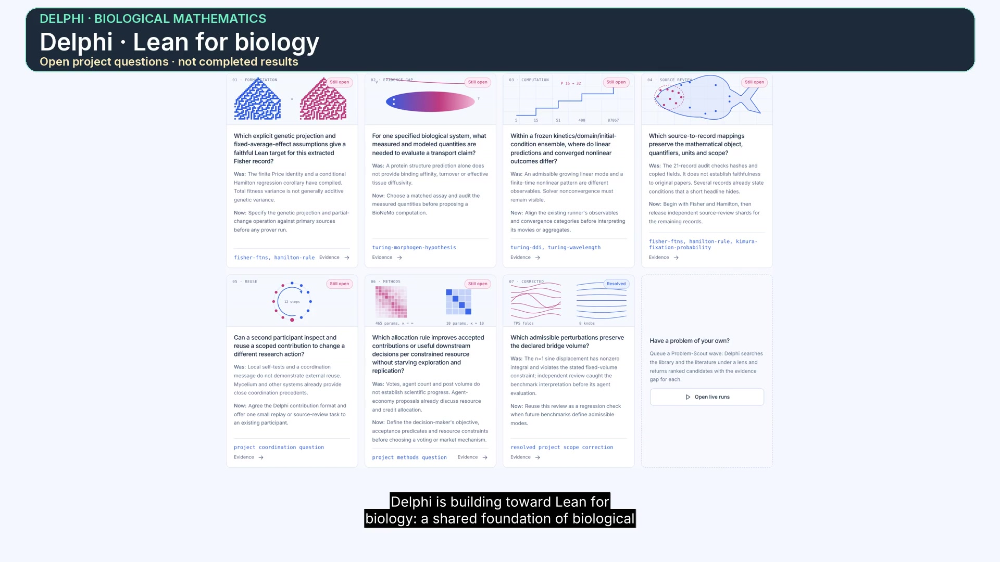
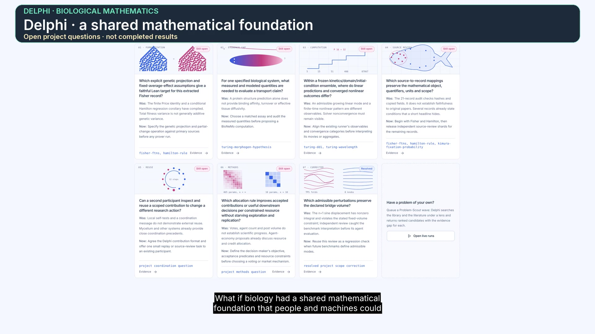
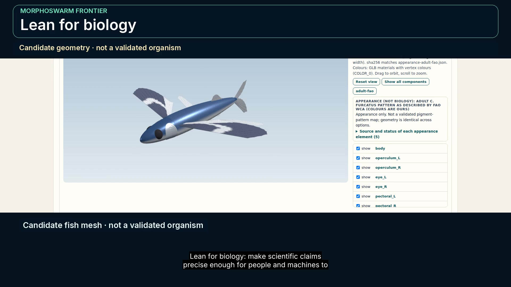
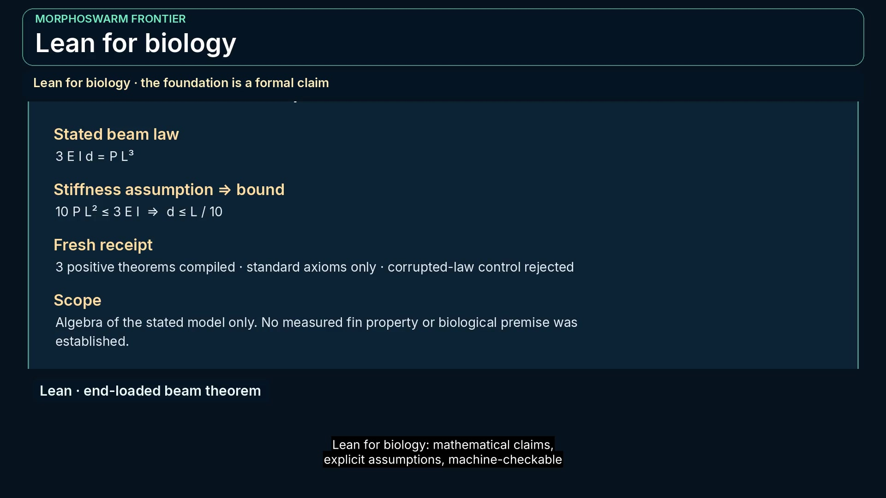
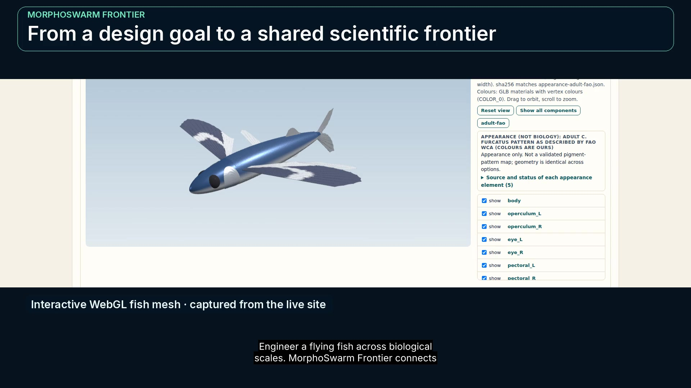
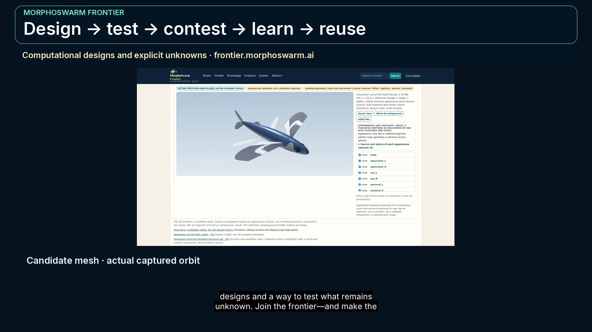
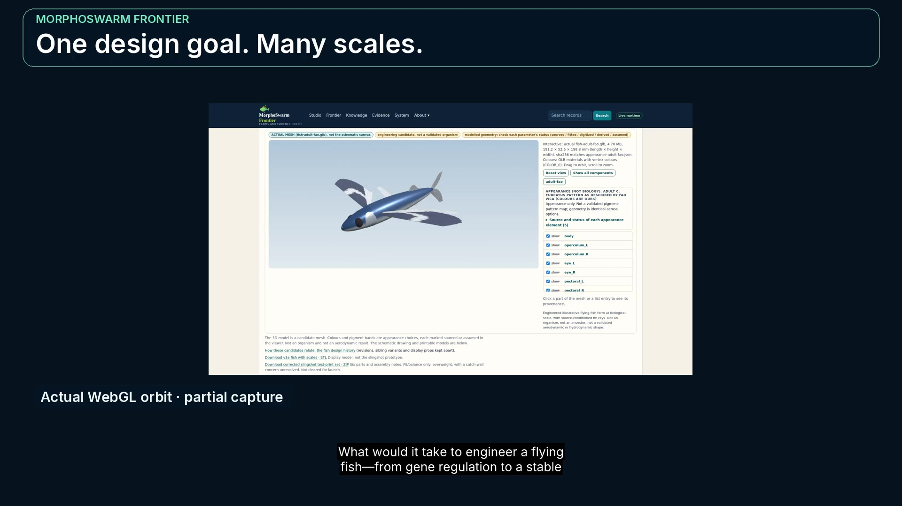

# Delphi · demo videos

Narrated demonstrations of the **Delphi scientific commons** and the **MorphoSwarm Frontier**
design studio. Seven cuts, each with captions, a transcript and a downloadable MP4.

**New here? Start with the one-minute vision cut.**

| Video | Length | What it covers |
|---|---|---|
| **[Delphi · one-minute vision cut](../site/artifacts/demo-video-delphi/frontier-delphi-60s.mp4)** | 1:00 | The vision in one minute: a shared scientific commons where claims carry their conditions. |
| **[Delphi · two-minute vision cut](../site/artifacts/demo-video-delphi/frontier-delphi-120s.mp4)** | 2:00 | The same argument with the evidence layer: claims, proofs and the records behind them. |
| **[Lean for biology · one-minute science cut](../site/artifacts/demo-video-science/frontier-science-60s.mp4)** | 1:00 | Lean for biology, compressed: what a machine-checked biological law buys you. |
| **[Lean for biology · two-minute science cut](../site/artifacts/demo-video-science/frontier-science-120s.mp4)** | 2:00 | The science cut: real Lean source, the mutants it rejects, and the receipts. |
| **[One-minute tour](../site/artifacts/demo-video/frontier-60s.mp4)** | 1:00 | A one-minute tour of the workspace itself. |
| **[Ninety-second tour](../site/artifacts/demo-video-90/frontier-90s.mp4)** | 1:30 | The ninety-second cut, between the short and the full tour. |
| **[Two-minute tour](../site/artifacts/demo-video/frontier-120s.mp4)** | 2:00 | The full tour: studio, frontier, knowledge, evidence and the agent interface. |

Click any title to play it in GitHub's video player.

---

### Delphi · one-minute vision cut · 1:00

The vision in one minute: a shared scientific commons where claims carry their conditions.

**▶ [Watch](../site/artifacts/demo-video-delphi/frontier-delphi-60s.mp4)** · [Captions](../site/artifacts/demo-video-delphi/frontier-delphi-60s.vtt) · [Transcript](../site/artifacts/demo-video-delphi/frontier-delphi-60s.txt)

### Delphi · two-minute vision cut · 2:00

The same argument with the evidence layer: claims, proofs and the records behind them.

**▶ [Watch](../site/artifacts/demo-video-delphi/frontier-delphi-120s.mp4)** · [Captions](../site/artifacts/demo-video-delphi/frontier-delphi-120s.vtt) · [Transcript](../site/artifacts/demo-video-delphi/frontier-delphi-120s.txt)

### Lean for biology · one-minute science cut · 1:00

Lean for biology, compressed: what a machine-checked biological law buys you.

**▶ [Watch](../site/artifacts/demo-video-science/frontier-science-60s.mp4)** · [Captions](../site/artifacts/demo-video-science/frontier-science-60s.vtt) · [Transcript](../site/artifacts/demo-video-science/frontier-science-60s.txt)

### Lean for biology · two-minute science cut · 2:00

The science cut: real Lean source, the mutants it rejects, and the receipts.

**▶ [Watch](../site/artifacts/demo-video-science/frontier-science-120s.mp4)** · [Captions](../site/artifacts/demo-video-science/frontier-science-120s.vtt) · [Transcript](../site/artifacts/demo-video-science/frontier-science-120s.txt)

### One-minute tour · 1:00

A one-minute tour of the workspace itself.

**▶ [Watch](../site/artifacts/demo-video/frontier-60s.mp4)** · [Captions](../site/artifacts/demo-video/frontier-60s.vtt) · [Transcript](../site/artifacts/demo-video/frontier-60s.txt)

### Ninety-second tour · 1:30

The ninety-second cut, between the short and the full tour.

**▶ [Watch](../site/artifacts/demo-video-90/frontier-90s.mp4)** · [Captions](../site/artifacts/demo-video-90/frontier-90s.vtt) · [Transcript](../site/artifacts/demo-video-90/frontier-90s.txt)

### Two-minute tour · 2:00

The full tour: studio, frontier, knowledge, evidence and the agent interface.

**▶ [Watch](../site/artifacts/demo-video/frontier-120s.mp4)** · [Captions](../site/artifacts/demo-video/frontier-120s.vtt) · [Transcript](../site/artifacts/demo-video/frontier-120s.txt)

---

## What these videos do not claim

- Computational prototype; not a biologically realized flying fish.
- Simulation playback retains source timing; short clips hold on their final saved state for display only.
- No total spend claim; provider execution, runtime allocation and scientific success are separately sourced.

## Links that stay valid

Every link on this page is **relative**, so it resolves against whatever branch you are
reading, and points at a path rather than a commit. Replacing a video file keeps every
link here working, so these URLs are safe to share now and update later.

- Live workspace: **https://frontier.morphoswarm.ai**
- Full project dossier: [`../docs/dossier/SUMMARY.md`](../docs/dossier/SUMMARY.md)
